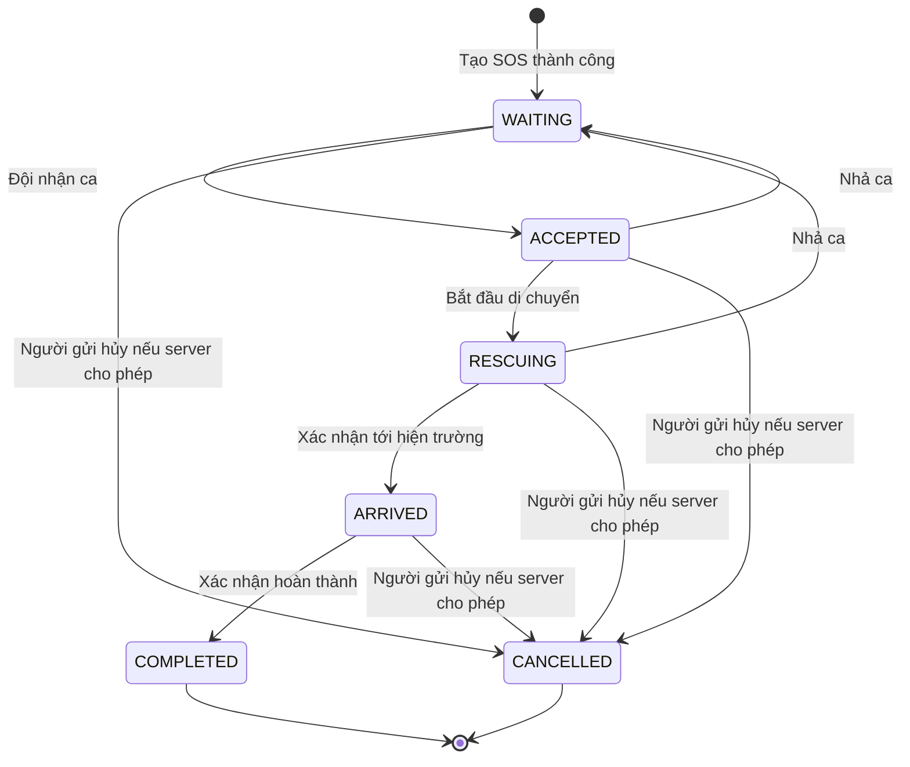
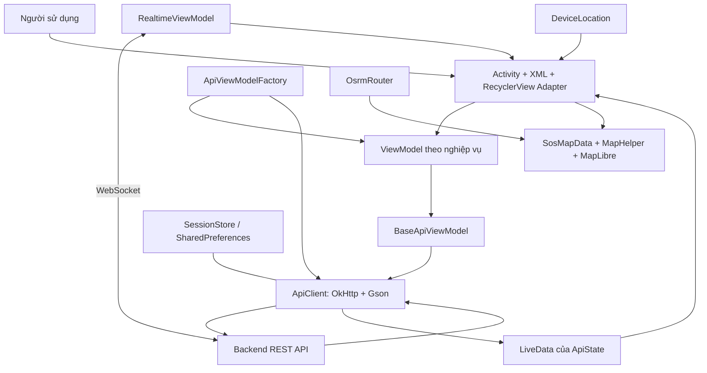
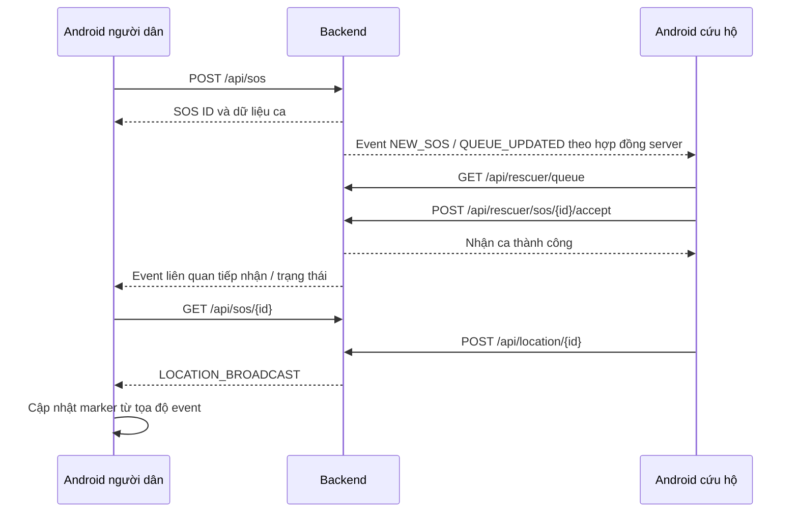

# Giải thích toàn bộ front-end Android SOS Rescue để thuyết trình

Tài liệu này giải thích project theo trình tự từ bài toán và cách sử dụng đến kiến trúc, cách viết code, giao tiếp mạng và các vấn đề nâng cao. Mục tiêu là đọc từ trên xuống sẽ hiểu được cả **ứng dụng làm gì**, **code tổ chức như thế nào** và **vì sao các thành phần phải phối hợp như vậy**.

Nội dung được đối chiếu trực tiếp với source trong repository tại thời điểm viết, ngày 18/11/2026. Những nhận xét về hành vi ứng dụng dựa trên code; tài liệu không coi việc có source kiểm thử là bằng chứng các kiểm thử đã chạy thành công. Backend không nằm trong repository này, vì vậy các quy tắc phía server được trình bày dưới góc độ hợp đồng mà Android client gọi và kỳ vọng.

## Mục lục

1. [Nhận diện project và bài toán cốt lõi](#1-nhận-diện-project-và-bài-toán-cốt-lõi)
2. [Nghiệp vụ SOS và vòng đời một ca cứu hộ](#2-nghiệp-vụ-sos-và-vòng-đời-một-ca-cứu-hộ)
3. [Nhìn toàn bộ ứng dụng qua các luồng màn hình](#3-nhìn-toàn-bộ-ứng-dụng-qua-các-luồng-màn-hình)
4. [Kiến trúc và cấu trúc thư mục](#4-kiến-trúc-và-cấu-trúc-thư-mục)
5. [Công nghệ, package và cấu hình build](#5-công-nghệ-package-và-cấu-hình-build)
6. [Model và cách biểu diễn dữ liệu](#6-model-và-cách-biểu-diễn-dữ-liệu)
7. [Giao diện XML và hệ thống thiết kế](#7-giao-diện-xml-và-hệ-thống-thiết-kế)
8. [Cách code một màn hình trong project](#8-cách-code-một-màn-hình-trong-project)
9. [HTTP, JSON, validation và xử lý lỗi](#9-http-json-validation-và-xử-lý-lỗi)
10. [Đăng nhập OTP và quản lý phiên JWT](#10-đăng-nhập-otp-và-quản-lý-phiên-jwt)
11. [Phân tích sâu luồng người dân](#11-phân-tích-sâu-luồng-người-dân)
12. [Phân tích sâu luồng cứu hộ và quản lý đội](#12-phân-tích-sâu-luồng-cứu-hộ-và-quản-lý-đội)
13. [GPS, bản đồ, khoảng cách và tìm đường](#13-gps-bản-đồ-khoảng-cách-và-tìm-đường)
14. [WebSocket và đồng bộ thời gian thực](#14-websocket-và-đồng-bộ-thời-gian-thực)
15. [Vòng đời Android và tính nhất quán dữ liệu](#15-vòng-đời-android-và-tính-nhất-quán-dữ-liệu)
16. [Kiểm thử và cách kiểm chứng project](#16-kiểm-thử-và-cách-kiểm-chứng-project)
17. [Điểm mạnh, giới hạn và hướng nâng cấp](#17-điểm-mạnh-giới-hạn-và-hướng-nâng-cấp)
18. [Cấu hình chạy và kịch bản demo](#18-cấu-hình-chạy-và-kịch-bản-demo)
19. [Dàn ý và lời dẫn thuyết trình](#19-dàn-ý-và-lời-dẫn-thuyết-trình)
20. [Câu hỏi phản biện thường gặp](#20-câu-hỏi-phản-biện-thường-gặp)
21. [Phụ lục toàn bộ endpoint phía client](#21-phụ-lục-toàn-bộ-endpoint-phía-client)
22. [Phụ lục tra cứu source và thuật ngữ](#22-phụ-lục-tra-cứu-source-và-thuật-ngữ)

## 1. Nhận diện project và bài toán cốt lõi

### 1.1. Đây là front-end Android native

Tên project Gradle là `JavaFinal`, tên ứng dụng hiển thị là **SOS Rescue**, package gốc là `com.javafinal`. Phần front-end ở đây là ứng dụng Android chạy trên điện thoại hoặc emulator, viết bằng **Java** cho logic và **XML** cho bố cục giao diện.

Các file `build.gradle.kts` dùng cú pháp Kotlin DSL để cấu hình build. Điều đó không có nghĩa logic ứng dụng được viết bằng Kotlin. Source chính hiện có 63 file Java và 21 file XML trong `res/layout`.

Khi thuyết trình, cách giới thiệu chính xác là:

> “Đây là ứng dụng Android native hỗ trợ tiếp nhận và điều phối yêu cầu cứu hộ SOS. Giao diện được xây dựng bằng Java, XML và Material Components; dữ liệu nghiệp vụ được lấy từ backend thông qua REST API và WebSocket.”

### 1.2. Ứng dụng giải quyết vấn đề gì?

Một người gặp sự cố cần gửi được ba nhóm thông tin: **đang gặp chuyện gì, đang ở đâu và cần được hỗ trợ**. Đội cứu hộ cần tiếp nhận thông tin đó, chọn ca phù hợp, di chuyển đến người cần cứu và cập nhật tiến trình cho hai bên.

Vì vậy, phần khó của ứng dụng vượt ra ngoài việc làm một form gửi SOS. Hệ thống còn phải giữ cho thông tin giữa hai thiết bị thống nhất: ca nào còn chờ, đội nào đã nhận, hai bên đang ở đâu, ca đã hoàn thành hay đã hủy.

Front-end đảm nhận việc nhập, hiển thị và đồng bộ những thông tin này. Quyết định nghiệp vụ cuối cùng, chẳng hạn một đội có được nhận ca hay một tài khoản có quyền sửa thành viên hay không, phải được backend xác nhận.

### 1.3. Hai nhóm người sử dụng

| Vai trò tài khoản | Mục tiêu chính | Chức năng tiêu biểu |
| --- | --- | --- |
| `USER` | Gửi yêu cầu và biết mình đang được hỗ trợ đến đâu | Xem bản đồ cộng đồng, tạo SOS, theo dõi, đổi chế độ hiển thị, hủy, xem kết quả |
| `RESCUER` | Tiếp nhận và xử lý yêu cầu cứu hộ | Xem hàng đợi, xem vị trí chính xác, nhận ca, cập nhật tiến trình, nhả ca, hoàn thành, xem lịch sử và đội viên |

Cần phân biệt vai trò tài khoản với vai trò trong đội. Một người có tài khoản `RESCUER` có thể là `MEMBER`, `LEADER`, `DRIVER` hoặc `MEDIC` trong một đội cụ thể. Quyền quản lý thành viên phụ thuộc vào thông tin membership của đội đang được chọn.

## 2. Nghiệp vụ SOS và vòng đời một ca cứu hộ

### 2.1. SOS là đối tượng trung tâm

Một ca SOS được biểu diễn chủ yếu bằng `SosRequest`. Đối tượng này liên kết người gửi, loại sự cố, mô tả, chế độ hiển thị, trạng thái, đội/người cứu hộ, vị trí và thời gian cập nhật.

Toàn bộ hành trình sử dụng có thể hiểu là các màn hình khác nhau cùng đọc hoặc thay đổi **một ca SOS có ID xác định**. ID được truyền giữa các Activity bằng Intent extra có tên `SOS_ID`; màn hình đích lấy ID rồi đọc lại dữ liệu từ server.

### 2.2. Trạng thái thể hiện tiến trình, visibility thể hiện quyền hiển thị

Hai khái niệm này độc lập. `status` trả lời “ca đang ở bước nào?”, còn `visibility` trả lời “ca được hiển thị theo chế độ nào?”. Một ca `PRIVATE` vẫn có thể đang `WAITING` hoặc `RESCUING`.

| Trường | Giá trị | Ý nghĩa |
| --- | --- | --- |
| `visibility` | `PUBLIC` | Có thể xuất hiện trên bản đồ cộng đồng với vị trí đã làm mờ từ server |
| `visibility` | `PRIVATE` | Dữ liệu được truy cập theo quyền cứu hộ; không xuất hiện như một điểm công khai cho người dân |
| `status` | `WAITING` | Chờ tiếp nhận |
| `status` | `ACCEPTED` | Đội cứu hộ đã nhận |
| `status` | `RESCUING` | Đang di chuyển, theo cách diễn giải của UI hiện tại |
| `status` | `ARRIVED` | Đã tới hiện trường |
| `status` | `COMPLETED` | Đã hoàn thành |
| `status` | `CANCELLED` | Đã hủy |

### 2.3. Luồng trạng thái chính



Sơ đồ thể hiện hành động mà client có thể yêu cầu. Điều kiện hủy thực tế, thời hạn, quyền sở hữu và các xung đột phải được backend kiểm tra. Không nên dùng sơ đồ này để khẳng định mọi yêu cầu hủy đều được chấp nhận.

`SosRules` cung cấp các hàm giúp UI bật/tắt hành động: nhận ca khi `WAITING`, nhả ca khi `ACCEPTED` hoặc `RESCUING`, hoàn thành khi `ARRIVED`, và chỉ chuyển tiếp `ACCEPTED → RESCUING → ARRIVED` theo thứ tự. `COMPLETED` và `CANCELLED` được xem là trạng thái kết thúc.

Trong danh sách lịch sử còn có nhãn `RELEASED`. Đây là giá trị được UI hỗ trợ để hiển thị lịch sử nhả ca; không nên thêm nó vào chuỗi trạng thái đang xử lý mà `SosRules` kiểm soát. Với hành động nhả ca, thông điệp giao diện mô tả yêu cầu quay lại hàng đợi.

Từ vòng đời này có thể hiểu vì sao ứng dụng cần hai giao diện khác nhau: người dân chủ yếu quan sát và quản lý yêu cầu của mình, còn cứu hộ thực hiện các bước tiếp nhận và xử lý.

## 3. Nhìn toàn bộ ứng dụng qua các luồng màn hình

### 3.1. Luồng khởi động và đăng nhập

Ứng dụng mở từ `SplashActivity`, được khai báo là launcher trong Manifest. Splash gọi `/health`; nếu thành công thì kiểm tra phiên. Có token thì gọi `/api/auth/me` để lấy tài khoản từ server; chưa có token thì mở `LoginActivity`.

Sau đăng nhập, tài khoản do server trả về quyết định mở `HomeActivity` hay `RescuerHomeActivity`. `MainActivity` chỉ là điểm chuyển tiếp dự phòng về Splash, không chứa màn hình nghiệp vụ chính. File `activity_main.xml` cũng không phải bố cục mà `MainActivity` hiện sử dụng.

### 3.2. Luồng người dân

```text
HomeActivity: bản đồ cộng đồng và SOS đang hoạt động
    → SendSosActivity: chọn sự cố, mô tả, vị trí, PUBLIC/PRIVATE
    → TrackSosActivity: theo dõi trạng thái và vị trí
    → SosResultActivity: kết quả đóng ca và nhật ký
```

Nếu đã có SOS đang hoạt động, trang chủ dẫn người dùng về ca đó. Tạo SOS mới chỉ điều hướng sang màn theo dõi sau khi nhận phản hồi thành công có mã ca, hoặc sau khi đọc lại được ca hiện có trong tình huống xung đột.

Thanh điều hướng người dân có các mục **Bản đồ**, **SOS của tôi**, **Thông báo**, **Hồ sơ**. “SOS của tôi” hiện mở ca đang hoạt động, không phải một màn hình lịch sử đầy đủ cho người dân. “Hồ sơ” mở bottom sheet.

### 3.3. Luồng cứu hộ

```text
RescuerHomeActivity: hàng đợi và ca đang xử lý
    → SosDetailActivity: đọc chi tiết và thông tin liên hệ
    → Nhận ca thành công
    → RealtimeTrackingActivity: vị trí và tiến trình
    → ConfirmCompleteActivity: kiểm tra ARRIVED và xác nhận
    → Trở về hàng đợi
```

Cứu hộ có thêm `RescuerMapActivity` để xem bản đồ tổng quan có vị trí chính xác, `RescuerMissionsActivity` để xem ca hiện tại và lịch sử, cùng `RescueTeamActivity` để xem hoặc quản lý thành viên theo quyền.

### 3.4. Các chức năng dùng chung

`NotificationActivity` hiển thị danh sách thông báo, hỗ trợ lọc và đánh dấu đã đọc. `NavigationHelper` cung cấp bottom sheet hồ sơ, đổi tên, đăng xuất, xác nhận thao tác, mở ứng dụng gọi điện hoặc SMS. Những chức năng này được tái sử dụng để các màn hình có cách tương tác thống nhất.

Sau khi đã nhìn thấy người dùng đi qua những màn hình nào, bước tiếp theo là tìm hiểu cách code chia trách nhiệm để phục vụ các hành trình đó.

## 4. Kiến trúc và cấu trúc thư mục

### 4.1. Kiến trúc theo hướng MVVM

Project tổ chức theo hướng **Model – View – ViewModel**, kết hợp một tầng mạng dùng chung. View gồm Activity, XML và Adapter; ViewModel cung cấp các thao tác nghiệp vụ/API dưới dạng `LiveData<ApiState<T>>`; Model chứa dữ liệu Java được ánh xạ với JSON.



Đây là MVVM ở mức thực dụng. Activity vẫn quản lý nhiều trạng thái màn hình, ghép dữ liệu, điều hướng và một số điều kiện nghiệp vụ. Chưa có tầng Repository hay UseCase riêng. Vì vậy, khi giới thiệu nên nói “tổ chức theo hướng MVVM”, không khẳng định đây là Clean Architecture đầy đủ.

### 4.2. Cây thư mục cần hiểu

```text
JavaFinal/
├── build.gradle.kts                 Cấu hình plugin cấp project
├── settings.gradle.kts              Repository và module :app
├── gradle.properties                Thuộc tính Gradle
├── gradlew / gradlew.bat            Gradle Wrapper
├── gradle/
│   ├── libs.versions.toml           Danh mục thư viện và phiên bản
│   └── wrapper/                     Phiên bản Gradle
├── app/
│   ├── build.gradle.kts             Android SDK, Java, BuildConfig, dependencies
│   ├── proguard-rules.pro           Cấu hình ProGuard bổ sung
│   └── src/
│       ├── main/
│       │   ├── AndroidManifest.xml  Khai báo ứng dụng, Activity và quyền
│       │   ├── java/com/javafinal/
│       │   │   ├── MainActivity.java
│       │   │   ├── model/           Entity, DTO và thông điệp WebSocket
│       │   │   ├── network/         HTTP, lỗi, phiên và protocol realtime
│       │   │   ├── viewmodel/       API và quy tắc hỗ trợ UI
│       │   │   ├── ui/              Base Activity và các nhóm màn hình
│       │   │   └── util/            GPS, bản đồ, tìm đường, định dạng, dialog
│       │   └── res/
│       │       ├── layout/          Bố cục màn hình, item và sheet
│       │       ├── values/          Màu, theme, style, chuỗi
│       │       ├── values-night/    Theme khi hệ thống ở chế độ tối
│       │       ├── drawable/        Vector icon và nền XML
│       │       ├── color/           Màu theo trạng thái component
│       │       ├── menu/            Hai menu điều hướng dưới
│       │       ├── mipmap-*/        Icon launcher theo mật độ màn hình
│       │       └── xml/             Quy tắc backup và chuyển thiết bị
│       ├── test/                    Unit test chạy trên JVM
│       └── androidTest/             Test giao diện trên thiết bị/emulator
└── ai_skills/                       Tài liệu API và hướng dẫn triển khai có sẵn
```

`build/`, `app/build/` và `.gradle/` là đầu ra hoặc cache build. `.idea/` và `.vscode/` phục vụ IDE. `local.properties` chứa cấu hình máy cục bộ như đường dẫn SDK, không phải cấu hình nghiệp vụ dùng chung.

Thư mục `ai_skills` trong repository chứa tài liệu tham khảo. Khi tài liệu cũ và code khác nhau, nội dung đang thực thi trong `app/src/main` là căn cứ chính để giải thích phiên bản hiện tại.

### 4.3. Luồng dữ liệu một chiều ở mức màn hình

Giả sử người dùng nhấn “Gửi SOS”. Activity đọc form rồi gọi `SosViewModel.createSos()`. ViewModel kiểm tra đầu vào và chuyển yêu cầu xuống `ApiClient`. Client gửi HTTP, nhận JSON, dùng Gson tạo đối tượng Java và trả kết quả về main thread. LiveData phát trạng thái; Activity nhận trạng thái để hiển thị lỗi hoặc chuyển sang màn theo dõi.

Điểm cần nhớ là **giao diện phản ứng với kết quả**, thay vì tự coi thao tác đã thành công ngay lúc bấm nút. Các thay đổi quan trọng của ca cứu hộ chờ server xác nhận.

## 5. Công nghệ, package và cấu hình build

### 5.1. Các thư viện được khai báo trực tiếp

Phiên bản dưới đây là phiên bản trong `gradle/libs.versions.toml`, không phải tuyên bố về phiên bản mới nhất trên thị trường.

| Thư viện / tọa độ package | Phiên bản | Được dùng làm gì trong project? |
| --- | --- | --- |
| `androidx.appcompat:appcompat` | `1.8.0` | `AppCompatActivity`, nền tảng cho các Activity và khả năng tương thích widget/theme |
| `com.google.android.material:material` | `1.14.0` | MaterialButton, Chip, BottomNavigationView, Toolbar, Card, BottomSheetDialog, Snackbar, TextInputLayout và progress indicator |
| `androidx.activity:activity` | `1.13.0` | Edge-to-edge, xử lý Back và Activity Result API để xin quyền |
| `androidx.constraintlayout:constraintlayout` | `2.2.2` | Công cụ bố trí giao diện được khai báo; các layout thực tế cũng dùng nhiều LinearLayout/FrameLayout/ScrollView |
| `org.maplibre.gl:android-sdk` | `13.7.1` | MapView, camera, marker, polygon, polyline và style bản đồ |
| `com.google.android.gms:play-services-location` | `21.3.0` | Fused Location Provider để nhận tọa độ thiết bị |
| `com.squareup.okhttp3:okhttp` | `4.12.0` | HTTP bất đồng bộ và kết nối WebSocket |
| `com.google.code.gson:gson` | `2.11.0` | Chuyển object Java thành JSON và parse JSON về model/DTO |
| `androidx.lifecycle:lifecycle-viewmodel` | `2.6.2` | ViewModel giữ đối tượng xử lý qua thay đổi cấu hình |
| `androidx.lifecycle:lifecycle-livedata-core` | `2.6.2` | MutableLiveData/LiveData để UI quan sát trạng thái và dữ liệu |

Source cũng sử dụng các lớp như RecyclerView, ViewCompat, ContextCompat và lifecycle observer. Những lớp này xuất hiện từ đồ thị dependency AndroidX mà các thư viện đang kéo vào; không phải mọi package import đều có một dòng `implementation` riêng trong module.

### 5.2. Thư viện kiểm thử và plugin build

| Thành phần | Phiên bản | Vai trò |
| --- | --- | --- |
| `junit:junit` | `4.13.2` | Assertion, setup/teardown và unit test |
| `androidx.test.ext:junit` | `1.3.0` | AndroidJUnit4 và tích hợp Android instrumentation |
| `androidx.test.espresso:espresso-core` | `3.7.0` | Tương tác và kiểm tra View khi test giao diện |
| Plugin `com.android.application` | `9.0.1` | Android Gradle Plugin, biên dịch module ứng dụng và đóng gói APK |
| Gradle Wrapper | `9.1.0` | Chạy build với phiên bản Gradle do project quy định |
| `org.gradle.toolchains.foojay-resolver-convention` | `1.0.0` | Hỗ trợ phân giải Java toolchain trong cấu hình Gradle |

`testImplementation` dành cho test JVM, còn `androidTestImplementation` dành cho test chạy trên Android. Dependency `implementation` mới là nhóm thư viện chính phục vụ ứng dụng.

### 5.3. Cấu hình Android và Java

Trong `app/build.gradle.kts`, `namespace` và `applicationId` đều là `com.javafinal`. `compileSdk = 36`, `targetSdk = 36`, `minSdk = 24`, `versionCode = 1` và `versionName = "1.0"`.

`minSdk` là mức API Android thấp nhất ứng dụng chấp nhận; API 24 tương ứng Android 7.0. `compileSdk` xác định bộ API dùng khi biên dịch. `targetSdk` cho Android biết ứng dụng nhắm đến mức hành vi nào. Ba giá trị phục vụ ba mục đích khác nhau.

`sourceCompatibility` và `targetCompatibility` cùng là Java 11. Trong khi đó, `gradle/gradle-daemon-jvm.properties` đang yêu cầu JVM toolchain JetBrains 25 để chạy Gradle daemon. **JDK chạy công cụ build** và **mức Java dùng để biên dịch source** là hai khái niệm riêng.

`buildFeatures { buildConfig = true }` cho phép sinh `BuildConfig.API_BASE_URL`. Giá trị đọc từ Gradle property `API_BASE_URL`, mặc định `http://10.0.2.2:8000/`. Bản release hiện đặt `isMinifyEnabled = false`, nên chưa bật bước rút gọn/obfuscate code bằng cấu hình release này.

### 5.4. Cách quản lý phiên bản

`libs.versions.toml` là Version Catalog: một nơi định nghĩa phiên bản và alias. Module chỉ cần viết `implementation(libs.okhttp)` hoặc `implementation(libs.maplibre)`. Cách này giúp dễ tìm phiên bản và giảm việc viết lặp tọa độ thư viện.

Project sử dụng OkHttp và Gson trực tiếp, tự viết lớp bọc API; chưa dùng Retrofit, Room, Hilt/Dagger hay Navigation Component. Điều hướng giữa các màn hình đang dùng Activity và Intent. Đây là lựa chọn triển khai có thể thấy trực tiếp trong source, không phải kết luận rằng các thư viện khác là bắt buộc.

Hiểu công cụ rồi, phần tiếp theo cần làm rõ dữ liệu mà các công cụ ấy vận chuyển và hiển thị.

## 6. Model và cách biểu diễn dữ liệu

### 6.1. Model nghiệp vụ và DTO có vai trò khác nhau

Model như `User`, `SosRequest` hoặc `RescueTeam` biểu diễn đối tượng mà ứng dụng quan tâm. DTO là đối tượng có hình dạng phù hợp với request hoặc response của một endpoint, ví dụ `CreateSosRequest`, `ActiveSosResponse`, `VerifyOtpResponse`.

Khi gọi API, client không cần tự ghép chuỗi JSON ở từng màn hình. Activity tạo DTO; Gson dựa vào field và `@SerializedName` để tạo đúng tên trường backend cần.

```java
@SerializedName("initial_lat")
private Double initialLat;

@SerializedName("initial_lng")
private Double initialLng;
```

Tên Java theo camelCase, tên JSON theo snake_case. Annotation là cầu nối giữa hai cách đặt tên. Một số trường có `alternate`, chẳng hạn `id`/`sos_id`, để hỗ trợ các cách trả dữ liệu đã được client dự tính.

### 6.2. Các nhóm model chính

| Model / nhóm DTO | Nội dung và mục đích |
| --- | --- |
| `User` | ID, tên, số điện thoại, vai trò, trạng thái tài khoản và thông tin liên quan |
| `AuthModels` | Gửi OTP, xác thực OTP, access token, hồ sơ và body đổi họ tên |
| `SosRequest` | Ca cứu hộ, người gửi, người cứu hộ, trạng thái, visibility, vị trí và dữ liệu hỗ trợ hiển thị tuyến đường |
| `SosApiModels` | Request/response cho SOS, hàng đợi, bản đồ, thông báo, vị trí, danh mục và đội |
| `PublicSosPoint` | Điểm công khai có `area_lat`/`area_lng`, loại sự cố và thời gian tạo |
| `EmergencyType` | Danh mục loại sự cố được tải từ API, hỗ trợ nhãn tiếng Việt và cache tra cứu |
| `RescueTeam`, `RescueTeamMember` | Đội, danh sách thành viên, vai trò membership và quyền quản lý |
| `TeamApiModels` | Thêm thành viên bằng số điện thoại, sửa role và nhận phản hồi thao tác |
| `LocationCurrent`, `LocationHistory` | Vị trí hiện tại và các điểm lịch sử của `VICTIM`/`RESCUER` |
| `SosLog` | Nhật ký hành động, mô tả và thời điểm |
| `SosNotification` | Loại thông báo, nội dung, đã đọc hay chưa và SOS liên quan |
| `WebSocketMessage` | Event, SOS ID, trạng thái, actor, tọa độ và các payload realtime |

### 6.3. Dữ liệu lồng nhau và dữ liệu dùng cho UI

Một response SOS có thể chứa các object `requester`, `rescuer`, `locations`, thay vì trả mọi thông tin ở cấp cao nhất. `SosRequest.syncFromNestedApiObjects()` cùng các getter hỗ trợ đưa dữ liệu đó về cách truy cập thuận tiện cho UI.

Ví dụ, màn hình muốn gọi `getRequesterPhone()` mà không lặp lại thao tác kiểm tra `requester != null` ở mọi vị trí. Một số response getter như `SosSingleResponse.getSos()`, `ActiveSosResponse.getSos()` và `RescuerQueueResponse.getData()` gọi hàm đồng bộ này.

Đổi lại, `SosRequest` đang đảm nhận khá nhiều vai trò: dữ liệu API, nhãn hiển thị, tính khoảng cách và giữ tuyến đường. Đây là điểm có thể tách nhỏ nếu quy mô ứng dụng tăng lên.

### 6.4. Phân biệt chưa có tọa độ với tọa độ bằng 0

`initialLat` và `initialLng` dùng kiểu `Double` để biểu diễn được `null`. Nếu chưa có dữ liệu thì không nên tạo marker ở `(0, 0)`, bởi `(0, 0)` vẫn là một vị trí hợp lệ trên Trái Đất.

`SosMapData.victim()` ưu tiên vị trí hiện tại từ `locations.victim`; nếu thiếu thì dùng tọa độ ban đầu khi `hasInitialLocation()` xác nhận cả hai trường tồn tại. Unit test có kiểm tra riêng trường hợp thiếu dữ liệu và trường hợp tọa độ thực bằng 0.

### 6.5. Danh mục động và cache nhãn

`EmergencyTypeViewModel.loadAll()` tải danh mục từ server rồi đưa vào cache trong `EmergencyType`. Các chip ở trang chủ, form gửi SOS và hàng đợi được tạo từ danh mục này. Client nhận cả `emergency_type_id` và tên/mã loại sự cố, thay vì chỉ chấp nhận một danh sách cố định trong app.

`EmergencyType.resolveLabel()` tra theo ID hoặc tên, tận dụng mô tả để có nhãn dễ đọc; nếu chưa tra được thì có các cách hiển thị dự phòng. Cache này là bộ nhớ trong tiến trình, không phải cơ sở dữ liệu offline.

## 7. Giao diện XML và hệ thống thiết kế

### 7.1. XML mô tả hình dạng, Java quyết định hành vi

Mỗi màn hình có một layout như `activity_login.xml`, `activity_send_sos.xml` hoặc `activity_realtime_tracking.xml`. XML khai báo cây View, kích thước, khoảng cách, style và ID. Java gọi `findViewById()` để lấy View rồi gắn dữ liệu hoặc sự kiện.

`R.layout.activity_send_sos` là mã tài nguyên do Android sinh cho file layout. `R.id.btnSubmitSos` là mã ID của nút. `R.color.red` và `R.drawable.ic_location` lần lượt trỏ đến màu và drawable. Lớp `R` được công cụ build sinh ra, không phải file cần tự viết.

Các đơn vị cũng có ý nghĩa: `dp` dùng cho kích thước và khoảng cách theo mật độ màn hình, `sp` dùng cho cỡ chữ để phù hợp thiết lập font của thiết bị. `match_parent`, `wrap_content`, `layout_weight`, LinearLayout và FrameLayout giúp chia vùng form, bản đồ và thanh điều hướng.

### 7.2. Thiết kế thống nhất từ tài nguyên dùng chung

`colors.xml` chọn nền trắng, chữ gần đen và đỏ làm điểm nhấn SOS. Các màu chính là `ink = #111111`, `red = #E5383B`, `green = #1E9E5A`, `amber = #C27C0E`; mỗi màu trạng thái có nền nhạt tương ứng.

`styles.xml` định nghĩa hệ chữ `Text.Display`, `Text.Headline`, `Text.Title`, `Text.Body`, `Text.Caption`; các style `Button.Primary`, `Button.Sos`, `Button.Secondary`; `Card`, `Chip.Minimal`, `Input`, `Toolbar.Minimal` và `BottomNav.Minimal`. Thay đổi một style có thể tác động đến nhiều màn hình đang dùng style đó.

Theme gốc là `Theme.Material3.Light.NoActionBar`. Project tự dùng MaterialToolbar khi cần, đồng thời có theme cho bottom sheet và snackbar. `values-night/themes.xml` dùng lại theme sáng; vì thế hiện chưa có dark mode toàn ứng dụng. Tùy chọn bản đồ tối chỉ thay style của bản đồ.

### 7.3. Màu theo trạng thái và dữ liệu preview

Các file `res/color/sel_*.xml` là color selector. Chúng quyết định màu khi component được chọn, nhấn hoặc vô hiệu hóa. Nhờ đó nút bị khóa và chip đang chọn có phản hồi thị giác rõ ràng.

`tools:text` cung cấp nội dung xem trước trong trình thiết kế; `android:text` mới là nội dung runtime. Nhiều vùng dữ liệu dùng `@string/data_pending`, tức dấu `—`, cho đến khi Java nhận dữ liệu thật. Cần phân biệt mẫu preview với dữ liệu được hiển thị khi chạy.

### 7.4. Các thành phần lặp lại

RecyclerView dùng layout item riêng: `item_sos_request.xml`, `item_rescuer_mission.xml`, `item_notification.xml`, `item_team_member.xml`. Adapter inflate item, gắn dữ liệu và trả sự kiện nhấn về Activity qua interface callback.

`item_chip_filter.xml` giúp tạo chip danh mục động mà vẫn giữ cùng thiết kế. `sheet_team_member.xml` là form bottom sheet thêm/sửa đội viên. Các bottom sheet khác có thể được dựng bằng Java trong `NavigationHelper`, phù hợp khi số hàng/nút tùy dữ liệu.

Với cấu trúc giao diện đã rõ, có thể đi vào mẫu code dùng chung để hiểu tại sao các Activity đều có cách gọi và xử lý API tương tự nhau.

## 8. Cách code một màn hình trong project

### 8.1. Các lớp cha giải quyết những vấn đề lặp lại

```text
AppCompatActivity
    └── ApiActivity
        ├── Các màn hình form, danh sách, kết quả, đăng nhập...
        └── MapApiActivity
            ├── HomeActivity, SendSosActivity, SosDetailActivity, RescuerMapActivity
            └── LiveSosActivity
                ├── TrackSosActivity
                └── RealtimeTrackingActivity
```

`ApiActivity` thiết lập layout, factory, vùng loading/lỗi/thử lại và các hàm điều hướng. `MapApiActivity` bổ sung khởi tạo MapLibre và chuyển tiếp vòng đời Activity cho MapView. `LiveSosActivity` bổ sung đọc chi tiết ca, vị trí, trail, realtime, polling và gửi GPS.

Như vậy, hai màn hình theo dõi dùng chung cơ chế đồng bộ nhưng tự định nghĩa cách hiển thị và hành động theo vai trò qua `onSosChanged()`, `onSosEnded()`, `canPublishGps()` và `fallbackRescuerLocation()`.

### 8.2. Mẫu khởi tạo một Activity

Các màn hình thường làm theo trình tự: gọi `super.onCreate()`, thiết lập layout, kiểm tra phiên, lấy ViewModel, lấy các View, đăng ký cách nhận kết quả, gắn sự kiện rồi tải dữ liệu cần thiết. Với màn hình bản đồ, bước khởi tạo bản đồ được thực hiện bất đồng bộ.

```java
setupScreen(R.layout.activity_sos_result);
if (!requireSession()) return;
sos = vm(SosViewModel.class);
sosId = getIntent().getStringExtra(SOS_ID);
```

`setupScreen()` có thêm xử lý edge-to-edge và WindowInsets để nội dung tránh status bar, navigation bar, vùng khoét màn hình và bàn phím. Nó bọc layout màn hình trong một vùng chứa có status panel dùng chung.

`requireSession()` chỉ kiểm tra client đang có token hay không. Đây là bước điều hướng sớm; quyền thực tế và hiệu lực token vẫn cần API xác nhận.

### 8.3. Factory tạo ViewModel và chia sẻ kết nối

`ApiViewModelFactory.getDefault(applicationContext)` giữ một factory mặc định trong tiến trình. Factory tạo `PreferencesSessionStore`, Gson, ApiClient và callback executor đưa công việc về main thread bằng Handler.

Mỗi lần Activity gọi `vm(SosViewModel.class)`, `ViewModelProvider` lấy hoặc tạo ViewModel trong phạm vi Activity đó. Các ViewModel dùng cùng ApiClient và session từ factory, nhưng **không phải mọi Activity đều dùng chung một instance ViewModel**. Tương tự, mỗi `RealtimeViewModel` có vòng đời và socket riêng của nó.

Đây là cách tiêm phụ thuộc thủ công: truyền `ApiClient` qua constructor. Constructor factory nhận sẵn ApiClient cho phép test thay transport/session mà không sửa logic nghiệp vụ.

### 8.4. ApiState diễn tả ba kết quả mà UI cần biết

`ApiState<T>` có ba trạng thái:

| Trạng thái | Dữ liệu đi kèm | UI thường làm gì? |
| --- | --- | --- |
| `LOADING` | Chưa có kết quả cuối | Hiện tiến trình, khóa thao tác liên quan |
| `SUCCESS` | `T data` | Render dữ liệu hoặc điều hướng |
| `ERROR` | `ApiError error` | Hiện thông báo, cho phép thử lại hoặc quay về đăng nhập |

`LiveData<ApiState<T>>` là nguồn trạng thái mà Activity quan sát theo lifecycle. `T` là generic, cho phép cùng cơ chế phục vụ `SosSingleResponse`, `UserResponse`, `LocationTrailResponse` và nhiều loại response khác mà vẫn có kiểu dữ liệu rõ ràng.

Mỗi lần gọi API tạo một LiveData riêng. Điều này tránh việc response của “tải vị trí” ghi đè response của “tải chi tiết” trong một biến trạng thái chung. Request bắt đầu khi gọi method, không chờ đến lúc có observer.

### 8.5. Bind khai báo cách xử lý, execute bắt đầu thao tác

`ApiActivity.bind(key, success, error, busy)` khai báo cách màn hình phản ứng với một loại request. `execute(key, action)` thực thi request và đưa nó vào nơi quản lý theo key.

Ví dụ rút gọn từ luồng tạo SOS, trong ngữ cảnh một Activity đã có các View và ViewModel:

```java
bind("create", (SosApiModels.SosSingleResponse response) -> {
    SosRequest created = response.getSos();
    if (created == null || created.getId() == null) {
        showStatus("Máy chủ chưa trả về mã SOS.", this::loadActive);
        return;
    }
    openSos(TrackSosActivity.class, created.getId());
    finish();
}, error -> {
    if (error.isConflict()) loadActive();
    else showApiError(error, null);
}, loading -> {
    busy = loading;
    updateSubmit();
    if (loading) showLoading("Đang gửi tín hiệu SOS…");
});

// Sau khi đọc và kiểm tra form:
execute("create", () -> sos.createSos(request));
```

Đoạn `response -> ...` là lambda nhận dữ liệu rồi xử lý. `this::loadActive` là method reference, nghĩa là truyền hành động để gọi sau. `Supplier` cung cấp thao tác tạo request khi `execute()` cần; `Consumer` nhận kết quả hoặc trạng thái busy.

### 8.6. ScreenRequests hạn chế bấm trùng và xử lý kết quả lặp

`ScreenRequests` là ViewModel riêng giữ ánh xạ `key → LiveData` và tập kết quả đã xử lý. Nếu một request cùng key còn `LOADING`, `execute()` không gửi thêm request đó. Khi response kết thúc, `consume()` bảo đảm kết quả của nguồn đang lưu chỉ được xử lý một lần.

Khi Activity được tạo lại do xoay màn hình, `bind()` có thể gắn lại với request chưa được xử lý đang giữ trong ViewModel. Cách này hữu ích với POST: không phải tự gọi lại mutation chỉ vì Activity chạy lại `onCreate()`.

Cơ chế này có phạm vi **màn hình và tiến trình hiện tại**. Nó không thay thế idempotency key ở backend, không bảo vệ mọi request giữa nhiều thiết bị và không tự khôi phục trạng thái sau khi hệ điều hành kết thúc tiến trình.

### 8.7. BaseApiViewModel gom quy trình request chung

`BaseApiViewModel.request()` tạo state loading, chạy validation, tạo OkHttp Call và đăng ký callback. Khi thành công, nó chạy bước xử lý bổ sung nếu có, rồi phát `ApiState.success(value)`. Khi lỗi, nó phát `ApiState.error(error)`.

Lớp này theo dõi Call đang chạy để hủy bằng `cancelRequests()` và trong `onCleared()`. Các method nghiệp vụ phải gọi từ main thread. Bản thân tác vụ mạng chạy bất đồng bộ; UI chỉ nhận kết quả đã được chuyển về main thread.

### 8.8. ViewModel được chia theo miền nghiệp vụ

| ViewModel | Trách nhiệm |
| --- | --- |
| `AuthViewModel` | OTP, lấy tài khoản hiện tại, phiên và đăng xuất |
| `UserViewModel` | Đọc hồ sơ và cập nhật họ tên |
| `SosViewModel` | Tạo/đọc SOS, bản đồ công khai, visibility, hủy và nhật ký |
| `RescuerViewModel` | Hàng đợi, ca hiện tại, lịch sử, bản đồ chính xác và hành động xử lý ca |
| `TeamViewModel` | Đội của tôi và thêm/sửa/xóa membership |
| `LocationViewModel` | Gửi vị trí, đọc vị trí hiện tại và trail |
| `NotificationViewModel` | Danh sách thông báo và đánh dấu đã đọc |
| `EmergencyTypeViewModel` | Đọc và thao tác danh mục loại sự cố |
| `SystemViewModel` | Kiểm tra endpoint health |
| `RealtimeViewModel` | WebSocket, heartbeat, subscribe và reconnect |

Các lớp nghiệp vụ ngắn vì tái sử dụng quy trình trong lớp cha. Ví dụ, `SosViewModel.loadDetail(id)` chủ yếu xác định method GET, path, yêu cầu xác thực, kiểu response và bước chuẩn hóa dữ liệu.

### 8.9. Adapter là cầu nối giữa list dữ liệu và từng hàng

RecyclerView chỉ quản lý việc hiển thị/tái sử dụng View. Adapter quyết định item được inflate từ XML nào, trường nào được gắn vào TextView, nút nào hiện/ẩn và callback nào phát ra khi nhấn.

`SosRequestAdapter` hiển thị các yêu cầu trong hàng đợi; `RescuerMissionAdapter` phân biệt ca hiện tại và ca lịch sử; `NotificationAdapter` hiển thị trạng thái đã đọc; `TeamMemberAdapter` hiện nút chỉnh sửa theo quyền.

Tên method `submitList()` ở một số adapter là hàm do project tự viết. Các adapter này kế thừa `RecyclerView.Adapter` và thường gọi `notifyDataSetChanged()`, không phải đang dùng AndroidX `ListAdapter` cùng DiffUtil.

### 8.10. Truy vết một thao tác từ đầu đến cuối

```text
1. Người dùng nhấn btnSubmitSos.
2. SendSosActivity.sendSos() đọc nội dung và lựa chọn.
3. Activity tạo SosApiModels.CreateSosRequest.
4. execute("create", ...) ngăn request cùng key chạy trùng.
5. SosViewModel.createSos() kiểm tra loại sự cố, visibility, tọa độ.
6. BaseApiViewModel.request() tạo state và quản lý Call.
7. ApiClient.newCall() tạo URL, body JSON và Bearer token.
8. OkHttp gửi HTTP ở tác vụ nền.
9. ApiClient đọc JSON và Gson chuyển sang SosSingleResponse.
10. Callback được đưa về main thread.
11. LiveData phát SUCCESS hoặc ERROR.
12. Binding của Activity mở màn theo dõi hoặc hiển thị lỗi.
```

Chuỗi này là phần nên hiểu kỹ nhất trước khi trình bày code. Các chức năng khác thay endpoint, DTO và xử lý kết quả, nhưng phần lớn dùng lại cùng cơ chế.

### 8.11. Nếu cần viết thêm một chức năng theo cách của project

Trước tiên xác định người dùng nào được thao tác, dữ liệu vào/ra và endpoint tương ứng. Tạo hoặc tái sử dụng DTO trong `model`, khai báo method ở ViewModel đúng miền nghiệp vụ và dùng `request()` để kế thừa trạng thái/lỗi/hủy thay vì tự viết lại HTTP trong màn hình.

Tiếp theo tạo layout với ID và style dùng chung, chọn lớp cha phù hợp: `ApiActivity` cho form/list, `MapApiActivity` khi có bản đồ, `LiveSosActivity` khi thật sự cần cơ chế theo dõi một ca. Activity lấy ViewModel qua factory, gọi `bind()` trước khi `execute()`, gắn listener và xử lý đầy đủ trạng thái bận, lỗi, rỗng và thành công.

Nếu tạo Activity mới thì cần khai báo Manifest và xác định cách truyền ID/điều hướng; nếu tạo loại API ViewModel mới thì factory phải biết cách khởi tạo nó. Những thao tác thay đổi dữ liệu nên bắt đầu từ sự kiện người dùng, không tự gửi lại chỉ vì `onCreate()` chạy lại. Tài nguyên có callback/timer cần có điểm dừng theo lifecycle.

Quy ước dễ thấy trong source là package chữ thường theo trách nhiệm, class PascalCase, field/method camelCase, hằng UPPER_SNAKE_CASE, layout/ID XML snake_case hoặc tên ID có tiền tố mô tả View. Source hiện có một số ID và helper còn tên cũ; nên đặt tên chức năng mới theo đúng dữ liệu nó biểu diễn để giảm nhầm lẫn. Chọn kiểm thử dựa trên hành vi mới có rủi ro, chẳng hạn body/query, quyền, xung đột hoặc response đến muộn.

## 9. HTTP, JSON, validation và xử lý lỗi

### 9.1. ApiClient là cửa giao tiếp REST dùng chung

`ApiClient` sở hữu base URL, OkHttpClient, Gson, session và callback executor. Màn hình không tự mở connection HTTP. ViewModel cũng không phải lặp lại logic parse lỗi hoặc gắn token ở từng endpoint.

`newCall()` đặt `Accept: application/json`. Nếu endpoint cần xác thực thì đọc token trong session và thêm `Authorization: Bearer <token>`. Không có token sẽ sinh lỗi unauthorized ở client. Body được Gson serialize với media type `application/json; charset=utf-8`.

POST/PUT không có body nghiệp vụ vẫn được gửi `{}`. DELETE có thể nhận HTTP 204; client chuyển trường hợp đó thành object rỗng để quy trình parse xử lý được. Các response thành công thông thường được kỳ vọng là **JSON object**, không phải một JSON array ở cấp gốc.

### 9.2. Tạo URL có kiểm soát

`ApiClient.url()` resolve đường dẫn trên base URL rồi kiểm tra scheme, host và port. `ApiClient.segment()` trim ID, từ chối rỗng/`.`/`..`, rồi encode ID như một path segment. Query như `actor`, `limit` và token WebSocket được xây bằng `HttpUrl.Builder`.

Những cách này giảm lỗi do tự nối chuỗi URL và giúp đầu vào có ký tự đặc biệt không bị hiểu thành đường dẫn khác. Đây là kiểm soát ở tầng tạo request; nó không thay thế phân quyền server.

### 9.3. Timeout và retry cần diễn giải chính xác

Client REST mặc định có connect timeout 15 giây, read timeout 30 giây và tổng call timeout 45 giây. `retryOnConnectionFailure(true)` được bật ở OkHttp.

Tầng ViewModel không có vòng lặp tự gửi lại POST khi nhận lỗi nghiệp vụ như 409 hoặc 429. Tuy nhiên, vì OkHttp có bật cơ chế phục hồi lỗi kết nối nên cũng không nên phát biểu “tuyệt đối không có retry ở bất kỳ tầng nào”. Muốn bảo đảm một thao tác chỉ tạo hiệu ứng một lần khi mạng chập chờn, cần thiết kế idempotency ở backend.

### 9.4. Validation nằm ở nhiều ranh giới

Activity kiểm tra điều kiện gắn với form; ViewModel kiểm tra giá trị trước khi tạo request; server tiếp tục kiểm tra quyền và nghiệp vụ trên dữ liệu thật.

| Điều kiện | Nơi có kiểm tra trong client |
| --- | --- |
| Số điện thoại dạng `0` + 9 chữ số hoặc `+84` + 9 chữ số | `InputValidator.phone()` |
| OTP đủ 6 chữ số | `AuthViewModel.verifyOtp()` |
| Vai trò tài khoản là `USER`/`RESCUER` | `InputValidator.role()` |
| Visibility là `PUBLIC`/`PRIVATE` | `InputValidator.visibility()` |
| Vĩ độ trong `[-90, 90]`, kinh độ trong `[-180, 180]`, không NaN/vô cực | `InputValidator.coordinates()` và `SosMapData.valid()` |
| Độ chính xác GPS hữu hạn, không âm | `LocationViewModel.updateLocation()` |
| Actor trail là `VICTIM` hoặc `RESCUER`; limit từ 1 đến 500 | `LocationViewModel.loadTrail()` |
| Mô tả SOS bắt buộc, tối đa 500 ký tự | `SendSosActivity.sendSos()` |
| Có loại sự cố bằng ID hoặc tên/mã | `SosViewModel.createSos()` |
| Chuyển trạng thái theo thứ tự khi đã có snapshot ca | Overload `RescuerViewModel.updateMissionStatus(SosRequest, status)` |

Validation ở client giúp phản hồi nhanh và tránh request vô ích. Nó không phải hàng rào bảo mật đáng tin cậy trước client đã bị sửa. Các điều kiện như một đội có ca khác chưa, một ca đã được đội khác nhận chưa và người dùng có sở hữu ca hay không vẫn do server quyết định.

### 9.5. Chuẩn hóa lỗi bằng ApiError

`ApiError.Kind` gồm `VALIDATION`, `NETWORK`, `HTTP`, `PARSE`, `BUSINESS`, `UNAUTHORIZED`, `CANCELLED`. Ngoài loại lỗi còn có HTTP status, message, detail và header `Retry-After` nguyên gốc.

Client phân biệt HTTP thất bại với trường hợp HTTP thành công nhưng JSON có `success: false`. Nó cũng đọc `detail` dạng chuỗi, object hoặc mảng thông báo lỗi kiểu FastAPI 422. Nhờ vậy Activity thường chỉ cần dùng `error.getMessage()`.

| Tình huống | Cách UI nên hiểu trong project |
| --- | --- |
| Mất mạng/timeout | Hiện lỗi kết nối; người dùng có thể thử đọc lại dữ liệu |
| HTTP 401 | Phiên không hợp lệ; điều hướng đăng nhập theo xử lý chung |
| HTTP 403 | Không đủ quyền; không tự cấp quyền trên client |
| HTTP 409 | Snapshot cũ hoặc xung đột nghiệp vụ; đọc lại ca/hàng đợi |
| HTTP 429 | Bị giới hạn tần suất; luồng OTP cập nhật thời gian chờ |
| JSON sai dạng | Hiện lỗi parse, không coi là dữ liệu hợp lệ |
| Request bị hủy | Có state CANCELLED; status panel chung bỏ qua lỗi này |
| `active: false`, `sos: null` | Thành công với ý nghĩa “chưa có ca hoạt động” |

### 9.6. Điểm chưa xác định trong hợp đồng

`/health` và endpoint DEV liên kết Telegram dùng `JsonObject` vì tài liệu trong repository chưa quy định đầy đủ schema. Chúng cần được đối chiếu với backend thực tế khi tích hợp.

Các method danh mục create/update/delete có trong ViewModel nhưng chưa có một màn hình quản trị danh mục tương ứng trong luồng ứng dụng chính. **Có wrapper API không đồng nghĩa đã có UI cho mọi endpoint**.

## 10. Đăng nhập OTP và quản lý phiên JWT

### 10.1. Luồng đăng nhập gồm hai bước

Trong `LoginActivity`, người dùng nhập số điện thoại và chọn vai trò yêu cầu. App gọi `POST /api/auth/request-otp`; nếu thành công thì chuyển từ vùng nhập số sang vùng nhập mã gồm sáu ô.

OTP được mô tả là nhận qua Telegram. App có đường dẫn bot được cấu hình trong `LoginActivity.TELEGRAM_BOT_URL`; nút mở bot dùng Intent `ACTION_VIEW`. Việc gửi mã và liên kết số điện thoại với Telegram là phần backend/bot; client không tự sinh OTP và không tự thực hiện liên kết DEV khi đăng nhập.

Nhập mã xong, app gọi `POST /api/auth/verify-otp`. Response phải có `access_token` và `user`. `AuthViewModel` lưu chúng vào session, rồi Activity điều hướng theo vai trò **server trả về**, không chỉ theo nút vai trò người dùng đã chọn.

### 10.2. Những chi tiết UX của màn OTP

TextWatcher chuyển focus sang ô tiếp theo khi nhập một chữ số; xử lý phím Delete giúp quay lại ô trước. CountDownTimer hiển thị thời gian gửi lại, mặc định 30 giây sau khi gửi mã thành công. Thời điểm chờ dùng `SystemClock.elapsedRealtime()` để tính thời gian đã trôi qua.

Khi server trả 429, UI thử đọc `Retry-After` dạng số giây; nếu không đọc được thì dùng 30 giây. Hết thời gian chờ trên UI chỉ có nghĩa nút có thể được bật lại, không có nghĩa client đã bỏ qua giới hạn phía server.

Vai trò đang chọn, số đang chờ OTP và thời điểm gửi lại được lưu trong Bundle khi Activity lưu state. Timer được hủy khi Activity bị destroy.

### 10.3. SessionStore và PreferencesSessionStore

`SessionStore` giữ token, user, version của phiên và listener nhận thay đổi. Các method truy cập chính dùng `synchronized`. `PreferencesSessionStore` kế thừa lớp này và lưu token/user vào SharedPreferences tên `api_session` bằng application context.

Do được lưu cục bộ, phiên có thể được đọc lại khi mở ứng dụng. Splash vẫn gọi `/auth/me` để xác minh với server. Lưu token không có nghĩa token còn hiệu lực mãi mãi.

Preferences dùng `MODE_PRIVATE`, nhưng code hiện không có lớp mã hóa token chuyên biệt. Hai file `backup_rules.xml` và `data_extraction_rules.xml` loại `api_session.xml` khỏi backup và chuyển thiết bị. Cần diễn đạt đúng: có giới hạn truy cập theo sandbox và loại khỏi backup, chưa thể gọi là “token đã được mã hóa an toàn tuyệt đối”.

### 10.4. Xử lý phản hồi của phiên cũ

Khi bắt đầu một request cần xác thực, `BaseApiViewModel` ghi nhận version của session. Nếu response thành công trở về sau khi phiên đã thay đổi, nó không tiếp tục áp dụng kết quả như dữ liệu của phiên mới.

Ở tầng ApiClient, HTTP 401 chỉ gọi `clearIfToken()` với token của request đó. Như vậy logic xóa phiên tại tầng transport tránh việc một response dùng token cũ trực tiếp xóa token mới. Luồng xác thực OTP cũng ghi nhận version trước khi lưu phiên.

Đây là những kiểm soát chống response đến muộn ở các lớp cụ thể. Không nên mở rộng thành khẳng định mọi đường xử lý UI đều miễn nhiễm race condition; phần giới hạn cuối tài liệu phân tích thêm điểm này.

### 10.5. Đăng xuất và xác thực lại

`AuthViewModel.logout()` hủy request auth đang chờ rồi xóa session. Các `RealtimeViewModel` đang lắng nghe phiên sẽ đóng kết nối và xóa subscription/message khi token thay đổi. UI mở Login với cờ xóa task để không Back trở về màn hình đã đăng nhập.

Chưa thấy cơ chế refresh token trong source. Khi phiên không còn hợp lệ, hướng xử lý của app là trở về đăng nhập. JWT được client mang theo để chứng minh phiên; kiểm tra chữ ký và quyền thuộc trách nhiệm của backend.

## 11. Phân tích sâu luồng người dân

### 11.1. HomeActivity: bản đồ cộng đồng và ca hiện tại

Trang chủ tải ba nhóm dữ liệu: danh mục loại sự cố, các điểm bản đồ công khai và SOS đang hoạt động của người dùng. Danh mục tạo chip lọc; public map tạo marker; ca đang hoạt động tạo banner và quyết định nút SOS mở màn gửi mới hay mở ca cũ.

Nút SOS ban đầu bị khóa cho đến khi đọc được trạng thái ca đang hoạt động. Cách này giảm nguy cơ người dùng gửi yêu cầu mới trong lúc app chưa biết đang có ca khác.

`HomeActivity` dùng `PublicSosPoint` và `SosMapData.drawPublic()`. Nó lấy tọa độ `area_lat`/`area_lng` do server trả về, không lấy chi tiết chính xác của người khác rồi tự che ở tầng hiển thị. Bộ lọc thực hiện trên danh sách đã tải về.

Khi màn hình bắt đầu hiển thị, nó tải lại dữ liệu, kết nối realtime và xin GPS để biểu diễn vị trí của chính thiết bị. GPS này phục vụ bản đồ; chu kỳ gửi vị trí cho một ca thuộc màn hình theo dõi.

### 11.2. SendSosActivity: thu thập một yêu cầu có thể gửi được

Form cần một loại sự cố, nội dung mô tả, vị trí hợp lệ và lựa chọn PUBLIC/PRIVATE. Danh mục lấy từ server, chip gắn object `EmergencyType` vào `tag` để truy ngược lựa chọn.

Vị trí ban đầu đến từ `DeviceLocation`. Nếu người dùng chạm bản đồ, `manualLocation = true`; các lần GPS tiếp theo không ghi đè điểm đã chọn. Nút lấy lại GPS đặt lại cờ để quay về vị trí thiết bị. Đây là quyết định UX quan trọng khi vị trí cần cứu hộ khác vị trí đang cầm điện thoại.

Các chip gợi ý nhanh bổ sung văn bản vào mô tả. `sendSos()` kiểm tra mô tả không rỗng và không quá 500 ký tự; `updateSubmit()` kiểm tra danh mục, lựa chọn, tọa độ và trạng thái busy để bật nút gửi.

Request gửi `emergency_type_id`, `emergency_type`, `description`, `visibility`, `initial_lat`, `initial_lng` theo dữ liệu đã chọn. Thành công mới mở theo dõi. Nếu nhận 409, app đọc lại `/api/sos/my-active` để tìm ca đang tồn tại thay vì tự tạo một ca giả trên client.

### 11.3. TrackSosActivity: người gửi biết tiến trình hiện tại

Màn hình này kế thừa `LiveSosActivity`, nên dùng chung cơ chế đọc chi tiết, hai vị trí, trail và WebSocket. Phần riêng hiển thị bước cứu hộ, thông tin đội, số liên hệ, loại sự cố, mô tả, thời gian tạo và chế độ hiển thị.

Người dùng có thể đổi PUBLIC/PRIVATE hoặc yêu cầu hủy. Đổi chế độ gọi API rồi đọc lại chi tiết. Hủy có bottom sheet xác nhận; khi server chấp nhận thì dừng gửi GPS và mở màn kết quả.

Khi đã có tuyến OSRM, thông tin đội có thể hiển thị khoảng cách đường bộ và số phút ước tính. Khi chưa có tuyến, một số trạng thái hiển thị Haversine với nhãn “đường thẳng”. Dữ liệu tuyến đường không quyết định ca đã đến nơi; tiến trình vẫn dựa trên trạng thái server.

### 11.4. SosResultActivity: kết quả cần được xác nhận lại

Màn hình tải chi tiết theo SOS ID. Nếu ca chưa kết thúc, nó đưa người dùng về theo dõi. Nếu đã `COMPLETED` hoặc `CANCELLED`, nó hiển thị trạng thái tương ứng, thời gian `updated_at`, đội, mô tả và `end_reason`, rồi tải `/logs` để hiển thị nhật ký.

Nút “báo người thân” dùng Android share sheet với `ACTION_SEND` và nội dung văn bản. Người dùng chọn ứng dụng và thao tác tiếp trong ứng dụng đó. Đây không phải API tự gửi tin nhắn cho một danh sách người thân. Dù một số comment cũ nhắc đến đánh giá, chưa có luồng gửi điểm đánh giá trong code hiện tại.

### 11.5. Hồ sơ và thông báo

Bottom sheet hồ sơ gọi GET profile để hiển thị tài khoản và PUT full-name khi đổi tên. Tên trong session/UI chỉ được cập nhật sau phản hồi hợp lệ của server. Đăng xuất cũng được cung cấp trong sheet này.

Thông báo được lọc theo tất cả, chưa đọc, cứu hộ, cảnh báo và hệ thống. Nhấn thông báo có SOS ID mở màn phù hợp với vai trò. Luồng đánh dấu đã đọc có cập nhật UI trước rồi gọi API; nếu lỗi, nó tải lại danh sách. Đây là ngoại lệ có optimistic update, khác với các hành động quan trọng của ca cứu hộ thường chờ server xác nhận.

## 12. Phân tích sâu luồng cứu hộ và quản lý đội

### 12.1. RescuerHomeActivity: hàng đợi là dữ liệu có thể thay đổi liên tục

Trang chủ cứu hộ tải danh mục, hàng đợi và ca đang xử lý của đội. Danh sách dùng `SosRequestAdapter`; chip lọc theo loại sự cố hoặc PUBLIC/PRIVATE trên dữ liệu hiện có. Các ô thống kê hiển thị tổng số chờ, số công khai và số riêng tư.

Một vài ID View còn mang tên cũ, ví dụ `tvHighPriorityCount` và `tvScanRadius`, nhưng code hiện gắn số công khai/riêng tư và XML đã đổi nhãn tương ứng. Khi thuyết trình cần đọc ý nghĩa đang hiển thị, không suy ra tính năng từ tên ID cũ.

Nút nhận ca chỉ được bật sau khi đã tải trạng thái ca hiện tại, đội chưa có ca và không đang nhận ca khác trong màn hình. Nếu hai đội cùng bấm nhận, client vẫn phải chờ API. Backend có thể trả 409; UI hiện thông báo và tải lại dữ liệu.

### 12.2. SosDetailActivity: đọc kỹ trước khi nhận

Màn hình lấy SOS ID rồi gọi chi tiết, hiển thị người cần cứu hộ, số điện thoại, mô tả, loại sự cố, visibility, thời gian và vị trí. Nút nhận dùng `SosRules.canAccept()` để chỉ bật khi snapshot đang WAITING.

Mở chi tiết không tự động nhận ca. Nhận thành công mới mở tác chiến realtime. Nếu xung đột, màn hình đọc ca đang hoạt động và có thể cho người dùng mở ca của đội mình.

Gọi điện dùng `ACTION_DIAL`, SMS dùng `ACTION_SENDTO`; app mở giao diện ứng dụng hệ thống để người dùng quyết định thực hiện tiếp. GPS của thiết bị giúp tính khoảng cách và lấy tuyến OSRM tới vị trí nạn nhân.

### 12.3. RealtimeTrackingActivity: xử lý đúng ca của đội

Màn hình gọi `/api/rescuer/my-active` và so ID với SOS đang mở. Chỉ khi khớp thì `ownAssignment` mới đúng. Các nút cập nhật và việc gửi GPS dựa vào điều kiện này cùng trạng thái ca.

Một nút chính đổi ý nghĩa theo tiến trình: ở ACCEPTED là “Bắt đầu di chuyển”, ở RESCUING là “Đã tới hiện trường”, ở ARRIVED là mở màn xác nhận hoàn thành. Hai bước đầu gọi API cập nhật status. Nút nhả ca chỉ xuất hiện khi `SosRules.canRelease()` cho phép.

Màn hình hiển thị khoảng cách còn lại từ OSRM nếu có; nếu chưa có thì dùng Haversine từ vị trí đội hoặc GPS thiết bị. Trường có ID `tvSpeed` thực tế hiển thị độ chính xác GPS dạng `±...m`; trường `tvEta` thực tế hiển thị nhãn trạng thái. Không nên trình bày chúng như tính năng đo tốc độ và ETA độc lập.

### 12.4. ConfirmCompleteActivity: hoàn thành là thao tác riêng

Màn hình đọc lại ca đang xử lý, xác nhận đúng SOS ID và kiểm tra trạng thái ARRIVED. Nút hoàn thành còn yêu cầu người dùng tích checkbox và không có request đang chờ.

POST complete thành công thì trở lại hàng đợi. Đến gần vị trí trên bản đồ hoặc lấy được tuyến đường ngắn không tự hoàn thành ca. Sự xác nhận rõ ràng giúp tránh đóng nhầm một yêu cầu còn đang hỗ trợ.

### 12.5. RescuerMapActivity: bản đồ dành cho người có quyền cứu hộ

Màn hình này kiểm tra user là rescuer rồi gọi `/api/rescuer/map`. Nó dùng `SosRequest` và vị trí chính xác cho cả PUBLIC lẫn PRIVATE. Các chip lọc theo loại sự cố và visibility; `SosMapData.drawRescuer()` vẽ marker tương ứng.

Điểm quan trọng là dùng **endpoint dành riêng cho cứu hộ**, thay vì biến bản đồ công khai thành bản đồ chính xác bằng cách suy diễn tọa độ. Nếu endpoint trả 401/403, danh sách điểm đang giữ được xóa khỏi màn hình trước khi hiển thị lỗi.

### 12.6. RescuerMissionsActivity: ca hiện tại và lịch sử

Màn hình đọc `/api/rescuer/missions` và ca đang hoạt động. Khi ghép danh sách, ca hiện tại được đưa lên đầu; phần lịch sử bỏ bản ghi có cùng ID để tránh lặp.

`RescuerMissionAdapter` làm nổi bật ca hiện tại, hỗ trợ nhãn hoàn thành và nhả ca. Nhấn ca hiện tại mở realtime; nhấn ca lịch sử mở bottom sheet nhật ký lấy từ `/api/sos/{id}/logs`.

Danh sách này phản ánh response của backend, không tự tổng hợp lịch sử đã nhận bằng bộ nhớ cục bộ. Bởi vậy khi tích hợp phải xác nhận backend có endpoint lịch sử mà client đang gọi.

### 12.7. RescueTeamActivity: membership quyết định quyền quản lý

`TeamViewModel.loadMyTeams()` gọi `/api/rescuer/teams/mine`. Nếu người dùng thuộc nhiều đội, Spinner cho chọn đội. Mỗi đội có `current_user_role`, `can_manage` và danh sách thành viên riêng.

`RescueTeam.canManage()` chỉ trả true khi server cho `can_manage = true` **và** vai trò tại đội là LEADER. Activity còn đòi đã tải xong quyền, đồng thời khóa thao tác khi đang tải/ghi. Vì vậy tài khoản rescuer hoặc nhãn trưởng nhóm ở đội khác không đủ để mặc nhiên sửa mọi đội.

Thêm thành viên dùng **số điện thoại tài khoản đã đăng ký** và vai trò. Sửa/xóa dùng **membership ID**, gắn với team ID, thay vì nhầm với user ID. Xóa membership là loại người đó khỏi đội, không xóa tài khoản.

Sau thao tác thành công, màn hình đóng editor và tải lại đội từ server. Khi bị 403, nó tải lại thông tin quyền. Hộp chỉnh sửa có chặn đóng trong lúc đang ghi và hiển thị lỗi phù hợp. Quy tắc sâu hơn như không được xóa trưởng nhóm cuối cùng, nếu có, phải được xác nhận từ backend; không nên tự khẳng định dựa vào UI này.

Các luồng nghiệp vụ đã cho thấy dữ liệu nào cần được cập nhật. Hai phần tiếp theo giải thích cách ứng dụng biết vị trí và truyền thay đổi giữa các thiết bị.

## 13. GPS, bản đồ, khoảng cách và tìm đường

### 13.1. Tách bốn trách nhiệm trước khi đọc code bản đồ

| Thành phần | Câu hỏi nó giải quyết |
| --- | --- |
| `DeviceLocation` | Thiết bị đang ở đâu, đã được cấp quyền lấy vị trí chưa? |
| `LocationViewModel` | Gửi vị trí lên backend và đọc vị trí/lịch sử của ca như thế nào? |
| `MapHelper`, `SosMapData`, MapLibre | Dùng style nào và vẽ những điểm/đường nào trên màn hình? |
| `OsrmRouter` | Có tuyến đường giao thông gợi ý giữa đội và nạn nhân không? |

GPS không tự tạo ra bản đồ; MapLibre không tự biết thiết bị ở đâu; OSRM không cung cấp bằng chứng đội đã thực sự di chuyển. Bốn trách nhiệm phối hợp với nhau để tạo trải nghiệm theo dõi.

### 13.2. DeviceLocation lấy vị trí thiết bị

Class này dùng `FusedLocationProviderClient` từ Google Play services. Nó đăng ký Activity Result API để xin `ACCESS_FINE_LOCATION` và `ACCESS_COARSE_LOCATION`; được một trong hai quyền thì có thể bắt đầu yêu cầu vị trí.

LocationRequest chọn `PRIORITY_HIGH_ACCURACY`, interval mong muốn 7.000 ms và min update interval 5.000 ms. Đây là các tham số yêu cầu, không phải cam kết điện thoại sẽ trả tọa độ chính xác tuyệt đối vào từng mốc thời gian.

Callback lấy vị trí mới nhất trong kết quả, cập nhật `latest` và chuyển cho màn hình. Nếu thiếu quyền hoặc không có vị trí, app thông báo để người dùng xử lý; không tự thay bằng tọa độ mẫu. Với màn gửi SOS, người dùng còn có thể chọn điểm thủ công.

### 13.3. Lấy GPS và gửi GPS là hai việc khác nhau

Trang chủ có thể cần GPS để vẽ vị trí của chính mình hoặc tính khoảng cách. Chỉ các màn hình theo dõi trong `LiveSosActivity` mới có cơ chế publish vị trí cho một ca qua `LocationViewModel.updateLocation()`.

Trước khi gửi, client phải đã đọc được ca còn hoạt động. Với cứu hộ, còn phải xác nhận đây là ca của đội mình và ca không ở WAITING. Body vị trí gồm `lat`, `lng`, `accuracy_m`, `save_history = true`; actor được hiểu theo phiên/nghiệp vụ server, không được app tự gán tùy ý trong body này.

`publishGps()` giới hạn tối thiểu khoảng 6 giây giữa các lần bắt đầu gửi. Ngoài ra key `gps` hạn chế request cùng loại đang chờ bị gửi chồng. Chu kỳ lấy GPS 7 giây, giới hạn gửi 6 giây và chu kỳ đọc lại 15 giây là ba cơ chế khác nhau.

### 13.4. MapLibre hiển thị dữ liệu, MapHelper quản lý cách thể hiện

`MapApiActivity` gọi khởi tạo MapLibre trước khi inflate layout có MapView. `getMapAsync()` trả về map; sau khi style tải xong mới đặt `mapReady = true` và render dữ liệu. Việc tách trạng thái map sẵn sàng tránh vẽ trước khi engine/style khởi tạo xong.

`MapHelper` xử lý style, camera, icon marker được vẽ bằng Canvas, info window và xung đột thao tác chạm giữa map với ScrollView. Camera có thể di chuyển tới một điểm hoặc fit một tập điểm vào khung nhìn.

Các kiểu bản đồ được cấu hình trong source:

| Lựa chọn giao diện | Nguồn/style được cấu hình |
| --- | --- |
| Đường phố | CARTO Voyager raster tile |
| “Bản đồ 3D” | OpenFreeMap Liberty vector style |
| Vệ tinh | Esri World Imagery raster tile |
| Giao diện tối | CARTO dark raster tile |

Tên hằng `LAYER_STREET_OSM` không có nghĩa app đang tải trực tiếp tile chuẩn từ máy chủ OSM. Tùy chọn mang nhãn “Bản đồ 3D” hiện chủ yếu chuyển sang vector style; source chưa có logic riêng dựng khối công trình 3D hoặc điều khiển một trải nghiệm 3D chuyên dụng.

### 13.5. Bản đồ công khai và bản đồ cứu hộ dùng dữ liệu khác nhau

Với người dân, `drawPublic()` vẽ `PublicSosPoint.areaLat/areaLng`. Vùng quanh điểm được tạo bằng `addFloodZonePolygon()` với bán kính theo độ và 28 đỉnh. Đây là vòng minh họa quanh vị trí đã làm mờ, không phải ranh giới ngập lụt đo từ dữ liệu thủy văn. Hàm còn được gọi cho điểm công khai nói chung, nên không nên diễn giải mọi vùng tô màu là một vùng ngập được xác minh.

Với cứu hộ, `drawRescuer()` lấy vị trí nạn nhân từ `SosRequest`, hiển thị cả PUBLIC và PRIVATE bằng màu phù hợp. Quyền xem dữ liệu chính xác phải do endpoint backend bảo vệ. Chỉ ẩn marker trên UI không đủ để bảo vệ tọa độ đã gửi xuống thiết bị.

Với ca đang theo dõi, `draw()` hiển thị marker nạn nhân và cứu hộ. Vị trí nạn nhân ưu tiên bản ghi hiện tại rồi tới vị trí ban đầu; cứu hộ ưu tiên dữ liệu server, và ở màn cứu hộ có thể dùng GPS thật của thiết bị làm điểm dự phòng.

### 13.6. Ba loại đường trên bản đồ có ý nghĩa khác nhau

`SosMapData.draw()` ưu tiên tuyến đường trong `SosRequest.getRoutePoints()`. Nếu chưa có tuyến thì vẽ các điểm lịch sử được tải từ API. Nếu cũng chưa đủ lịch sử nhưng biết hai vị trí thì vẽ đoạn nối trực tiếp.

| Đường hiển thị | Nguồn | Có thể kết luận điều gì? |
| --- | --- | --- |
| Tuyến OSRM | Dịch vụ định tuyến | Một tuyến lái xe gợi ý trên mạng đường giao thông |
| Trail | `LocationHistory` từ backend | Các điểm vị trí đã được ghi nhận; đường nối giữa chúng chỉ là cách thể hiện |
| Đoạn nối hai marker | Hai tọa độ hiện có | Hướng tương đối giữa hai bên; không bảo đảm đi được theo đoạn đó |

Marker lấy từ vị trí được ghi nhận hoặc GPS thật, không được chạy tự động dọc tuyến OSRM. Model còn giữ một số hàm cũ như `advanceAlongRoute()` và `snapRescuerToDestination()`, nhưng tìm kiếm call site trong source chính cho thấy luồng UI hiện tại không gọi chúng để mô phỏng chuyển động.

### 13.7. Haversine tính khoảng cách đường thẳng

`SosRequest.computeHaversineKm()` tính khoảng cách cung ngắn giữa hai tọa độ theo mô hình Trái Đất hình cầu, dùng bán kính 6.371 km. Trong cách gọi quen thuộc của UI, nó được ghi là khoảng cách “đường thẳng”.

```text
a = sin²(Δlat / 2) + cos(lat1) × cos(lat2) × sin²(Δlng / 2)
c = 2 × atan2(√a, √(1 − a))
d = 6371 × c   (km; các góc được đổi sang radian)
```

Khoảng cách này hữu ích khi chưa có đường đi, nhưng không phản ánh cầu, sông, đường vòng hoặc địa hình. Vì vậy không được tự coi số km Haversine là quãng đường xe cứu hộ cần đi.

### 13.8. OsrmRouter tìm tuyến đường gợi ý

`OsrmRouter` dùng một OkHttpClient riêng để gọi URL đã cấu hình `https://router.project-osrm.org/route/v1/driving/`. Profile trong source là **driving**. Không nên dựa vào comment có nhắc đi bộ để giới thiệu rằng ứng dụng đang hỗ trợ đồng thời nhiều loại phương tiện.

Request có dạng `startLng,startLat;endLng,endLat?overview=full&geometries=geojson`. OSRM và GeoJSON dùng thứ tự kinh độ trước; khi lưu cho MapLibre, code đổi sang mảng `[lat, lng]`. Đổi nhầm thứ tự là lỗi thường gặp nên unit test có kiểm tra trực tiếp bước chuyển đổi này.

Client lấy tuyến đầu tiên, đọc `distance` từ mét sang km và `duration` từ giây sang phút. `setOsrmRoute()` lưu tuyến/khoảng cách/thời gian mà không thay vị trí thực của cứu hộ. UI có thể hiển thị thời gian gợi ý ở một số vùng thông tin, nhưng chưa phải một hệ thống ETA có giao thông thời gian thực.

### 13.9. Cache tuyến và cách ứng dụng chịu lỗi

OSRM có timeout ngắn riêng: connect/read 5 giây, call 6 giây. Cache theo chuỗi tọa độ làm tròn bốn chữ số thập phân; tập `IN_FLIGHT` hạn chế gọi trùng cùng key. Việc làm tròn tạo các ô tọa độ gần nhau, không phải phép kiểm tra chính xác “đã di chuyển đủ bao nhiêu mét”.

Nếu lấy tuyến thất bại, callback không cung cấp tuyến mới; phần vẽ có thể dùng trail hoặc đoạn nối trực tiếp và phần tính khoảng cách có thể dùng Haversine. Không cần làm giả một tuyến đường phố để lấp chỗ trống. Tuy vậy, tuyến cũ có thể vẫn đang được giữ; đây là điểm cần quản lý độ cũ khi nâng cấp.

## 14. WebSocket và đồng bộ thời gian thực

### 14.1. REST đọc/ghi dữ liệu, WebSocket thông báo thay đổi

REST phù hợp cho hành động rõ ràng như tạo SOS, nhận ca, đọc chi tiết hoặc gửi một vị trí. Nếu chỉ dùng REST mà không đọc liên tục, thiết bị khác sẽ chưa biết thay đổi vừa xảy ra. WebSocket giữ kết nối để server có thể đẩy event mới xuống client.

Trong project, vị trí thiết bị được **gửi lên qua HTTP POST**. Vị trí mới và các thay đổi được **nhận về qua WebSocket**. Không nên gộp hai chiều thành phát biểu rằng app đang gửi GPS trực tiếp bằng socket.



Sơ đồ mô tả cách client sử dụng các hợp đồng; việc server phát event nào đến phòng/vai trò nào cần được kiểm chứng khi chạy tích hợp.

### 14.2. Kết nối và đăng ký theo ca

`RealtimeViewModel.connect()` yêu cầu có phiên đăng nhập rồi mở endpoint `/ws?token={jwt}` bằng OkHttp. `subscribeSos(id)` đưa SOS ID vào tập subscription; có thể gọi trước khi socket mở. Khi handshake thành công, client gửi đăng ký cho các ID đang giữ.

`RealtimeProtocol` tạo gói gửi dùng trường `type`:

```json
{"type":"SUBSCRIBE_SOS","sos_id":"<ma-sos>"}
```

```json
{"type":"PING"}
```

Gói nhận chấp nhận `type` hoặc `event` rồi chuẩn hóa vào `WebSocketMessage.getEvent()`. Nếu cùng có cả hai trường thì code hiện lấy `type` để gán `event`. Chuẩn hóa ở ranh giới mạng giúp phần UI chỉ cần đọc một tên thuộc tính.

### 14.3. Các event quan trọng

| Event | Ý nghĩa client quan tâm |
| --- | --- |
| `PONG`, `SUBSCRIBED` | Phản hồi điều khiển kết nối/đăng ký |
| `NEW_SOS`, `QUEUE_UPDATED` | Có thay đổi cần đọc lại hàng đợi hoặc bản đồ |
| `SOS_ACCEPTED`, `STATUS_CHANGED`, `SOS_RELEASED` | Ca có tiến trình mới, cần đồng bộ dữ liệu |
| `LOCATION_BROADCAST` | Có vị trí mới của VICTIM hoặc RESCUER |
| `SOS_COMPLETED`, `SOS_CANCELLED` | Kết thúc theo dõi và cập nhật màn hình |

Các màn hình xử lý event hơi khác nhau. Trang chủ/hàng đợi thường tải lại danh sách khi có event nghiệp vụ; `LiveSosActivity` cập nhật trực tiếp `locations` khi nhận `LOCATION_BROADCAST`, rồi render marker. Với event khác của đúng ca, nó đọc lại chi tiết hoặc kết thúc theo dõi.

### 14.4. Heartbeat và reconnect

Sau khi socket mở, scheduler gửi JSON PING mỗi 25 giây. Khi mất kết nối có thể phục hồi, thời gian chờ nối lại tăng theo 1, 2, 4, 8, 16 rồi tối đa 30 giây. Kết nối lại thành công sẽ đăng ký lại các phòng đã giữ và xóa lỗi kết nối hiện tại.

`generation` và kiểm tra socket/token giúp callback của lần kết nối cũ không tiếp tục tác động sau khi đã có lần mới hoặc đã disconnect. Khi token thay đổi, listener đóng socket, xóa subscription và message cũ.

Nếu lỗi xác thực/phân quyền, client dừng reconnect; HTTP handshake 401/403 và các close code tương ứng được xử lý riêng. Không nên thử nối vô hạn bằng một token đã hết hiệu lực.

Heartbeat hiện là cơ chế gửi PING định kỳ. Source chưa có bộ đếm hạn chờ PONG để phát hiện mọi trường hợp kết nối treo nhưng chưa bị đóng; vì thế không nên gọi cơ chế này là bảo đảm phát hiện mất kết nối trong đúng 25 giây.

### 14.5. Polling bù cho event bị bỏ lỡ

WebSocket có thể bị ngắt hoặc bỏ lỡ event trong lúc app không hiển thị. `LiveSosActivity` dùng Handler chạy đọc lại mỗi 15 giây, tải chi tiết rồi tải current locations và trail; nó cũng đọc lại khi kết nối realtime mở thành công.

Kết quả là màn hình theo dõi có hai nguồn đồng bộ: event giúp cập nhật nhanh, REST giúp xác nhận và khôi phục snapshot. Polling 15 giây này thuộc màn hình theo dõi, không phải một vòng polling toàn ứng dụng cho tất cả các trang.

### 14.6. Message LiveData không phải hàng đợi event

`getMessages()` giữ thông điệp mới nhất. Observer gắn lại có thể nhận lại message đó, vì vậy các tác vụ render/tải lại cần có tính idempotent: xử lý cùng một thông tin nhiều lần không tạo thêm ca hay thực hiện lại một mutation.

`RealtimeViewModel` hỗ trợ kết nối nhưng màn hình sử dụng phải thực sự gọi `connect()`. Riêng `NotificationActivity` hiện có observer message/error nhưng không có lời gọi connect/disconnect cho ViewModel của chính nó. Danh sách thông báo vẫn được đọc khi mở hoặc resume; chưa nên quảng bá màn này như một trung tâm nhận realtime độc lập đã hoàn chỉnh.

## 15. Vòng đời Android và tính nhất quán dữ liệu

### 15.1. Tại sao lifecycle quan trọng với ứng dụng này?

Người dùng có thể xoay điện thoại, chuyển app, mở một màn khác hoặc quay lại sau khi mất mạng. Nếu app giữ GPS, timer và socket không đúng vòng đời, nó có thể tốn pin, gửi vị trí khi không cần hoặc cập nhật nhầm giao diện cũ.

Project dùng ba nhóm cơ chế: LiveData quan sát theo lifecycle, ViewModel giữ công việc qua thay đổi cấu hình và các lớp quản lý tài nguyên có start/stop/clear rõ ràng.

### 15.2. Các hành động vòng đời hiện có

| Thành phần | Khi bắt đầu / sử dụng | Khi dừng / giải phóng |
| --- | --- | --- |
| `MapApiActivity` | Chuyển onCreate/onStart/onResume cho MapView | Chuyển onPause/onStop/onDestroy, low memory và save state |
| `DeviceLocation` | Xin quyền, chỉ start khi Activity ít nhất STARTED | Lifecycle observer ngừng location updates ở onStop, stop ở onDestroy |
| `LiveSosActivity` | Connect socket, đọc ca và bắt đầu polling ở onStart | Gỡ lịch polling, disconnect, hủy request vị trí ở onStop |
| `RealtimeTrackingActivity` | Đọc ca được giao để xác minh quyền gửi GPS | Đặt lại `ownAssignment` khi stop |
| `BaseApiViewModel` | Theo dõi các OkHttp Call | Hủy Call trong cancelRequests/onCleared |
| `RealtimeViewModel` | Tạo heartbeat và lịch reconnect khi cần | Disconnect; onCleared gỡ listener và shutdown scheduler |
| `LoginActivity` | CountDownTimer cho gửi lại OTP | Hủy timer trong onDestroy |

`LiveSosActivity` đặt lại `fresh = false` khi rời màn hình; lần trở lại cần có dữ liệu ca mới trước khi đủ điều kiện publish GPS. `DeviceLocation` tự ngừng cập nhật khi Activity stop. Manifest có quyền foreground service nhưng không khai báo một service theo dõi vị trí đang hoạt động trong project này.

### 15.3. Khi ca kết thúc phải dừng toàn bộ theo dõi liên quan

`endTracking()` đặt cờ ended, gỡ lịch polling, dừng GPS, hủy request location, đóng socket, xóa marker rồi gọi `onSosEnded()`. Người dân được đưa tới màn kết quả, cứu hộ về trang chủ.

Mục tiêu là tránh tiếp tục gửi vị trí cho một ca đã hoàn thành/hủy và tránh callback đến muộn làm màn hình quay về một trạng thái đang xử lý. `ended`, `initialized`, `fresh`, `ownAssignment` và `changing` có các vai trò riêng trong điều kiện thực thi.

### 15.4. Dữ liệu server là nguồn xác nhận nghiệp vụ

Hai thiết bị có thể cùng thấy một ca WAITING rồi cùng nhận. Không thể ngăn hoàn toàn tình huống này bằng cách khóa nút ở một điện thoại. Client chỉ khóa thao tác cục bộ, gửi yêu cầu và xử lý response; server cần kiểm tra nhận ca một cách nhất quán, trả xung đột cho phía không được nhận.

Tương tự, sau nhận/nhả/đổi visibility hoặc thay thành viên, app đọc lại snapshot cần thiết thay vì tự xây một phiên bản nghiệp vụ riêng bằng dữ liệu cũ. Một vài vùng UI có dùng response vừa nhận để cập nhật sớm, nhưng vẫn đối chiếu bằng request đọc lại.

### 15.5. State được giữ đến đâu?

ViewModel và ScreenRequests giữ request qua thay đổi cấu hình trong cùng tiến trình. Bundle giữ các giá trị chọn lọc như tọa độ, loại sự cố đang chọn, role OTP, bộ lọc hoặc team ID. SharedPreferences giữ phiên đăng nhập qua lần mở app.

Chưa có SavedStateHandle hay kho dữ liệu bền vững cho toàn bộ màn hình. Không nên đánh đồng “giữ được ViewModel khi xoay” với “khôi phục được mọi thứ sau process death” hoặc “hoạt động offline”. Những giới hạn này dẫn tới phần đánh giá và nâng cấp bên dưới.

## 16. Kiểm thử và cách kiểm chứng project

### 16.1. Các lớp test đang có trong source

| File | Cách kiểm thử | Nội dung đáng chú ý |
| --- | --- | --- |
| `ApiViewModelTest.java` | JVM, OkHttp interceptor và session thử nghiệm | Method/path/header/body/query, validation, parse, lỗi, session cũ, trạng thái SOS, bản đồ cứu hộ và quản lý đội viên |
| `RealtimeViewModelTest.java` | JVM với server WebSocket loopback tự dựng | Handshake, token, subscribe, event, reconnect, đăng ký lại và dừng khi logout |
| `SosMapDataTest.java` | JVM, dữ liệu JSON định sẵn | Thiếu tọa độ, tọa độ bằng 0, ưu tiên vị trí hiện tại, parse tuyến OSRM và không sửa vị trí thật khi lưu tuyến |
| `ApiScreenIntegrationTest.java` | Instrumentation, ActivityScenario, Espresso và transport thử nghiệm | Đăng nhập, dữ liệu trang chủ, hồ sơ, thông báo, tạo SOS, realtime, hủy/kết quả, tiến trình cứu hộ, hoàn thành và xung đột nhận ca |
| `ExampleUnitTest.java`, `ExampleInstrumentedTest.java` | Test mẫu | Kiểm tra cơ bản từ bộ khung project, không đại diện cho kiểm thử toàn bộ nghiệp vụ |

HTTP unit test dùng interceptor tạo response có kiểm soát, không gọi backend cứu hộ thật. Test WebSocket dùng loopback, phù hợp kiểm tra transport/reconnect ở local. Test giao diện thay factory/session để dữ liệu thử chỉ nằm trong source test.

Một số test/helper còn có tên lịch sử nhắc “32 API”, nhưng code hiện bổ sung missions, bản đồ cứu hộ và quản lý membership. Nên mô tả phạm vi bằng các chức năng thực sự được kiểm tra thay vì đọc tên method rồi suy ra số lượng endpoint hiện tại.

### 16.2. Những gì các test này chưa tự chứng minh

Test client có thể chứng minh app tạo request và xử lý response như thiết kế. Chúng chưa tự chứng minh backend đã triển khai đúng mọi endpoint, phân quyền server không có lỗi, GPS ổn trên mọi máy, dịch vụ tile/OSRM luôn sẵn sàng hoặc ứng dụng đạt yêu cầu vận hành cứu hộ thực tế.

`ApiScreenIntegrationTest` được gắn điều kiện SDK từ 29. Vì app cho phép minSdk 24, vẫn cần kiểm chứng các thiết bị/API thấp hơn và khác nhau về kích thước, quyền vị trí, bàn phím hoặc quản lý nền.

### 16.3. Các lệnh kiểm tra phù hợp

Chạy trong thư mục gốc project trên Windows:

```powershell
# Unit test JVM
.\gradlew.bat :app:testDebugUnitTest --console=plain

# Biên dịch APK debug
.\gradlew.bat :app:assembleDebug --console=plain

# Kiểm tra Android Lint
.\gradlew.bat :app:lintDebug --console=plain

# Test trên emulator/thiết bị đã kết nối
.\gradlew.bat :app:connectedDebugAndroidTest --console=plain
```

Có thể thêm `--offline` nếu máy đã có đầy đủ Gradle, SDK/toolchain và dependency trong cache. Tùy chọn đó không tự tải được thành phần còn thiếu. Trong lượt biên soạn tài liệu này chưa chạy các lệnh build/test trên, nên không có kết luận mới về trạng thái pass/fail.

### 16.4. Cách trình bày phần kiểm thử khi bảo vệ

Nên nêu một vài tình huống có giá trị: đầu vào sai không đi ra mạng; HTTP 409 khiến client đồng bộ lại; response phiên cũ bị kiểm soát; thiếu tọa độ không thành marker `(0, 0)`; lưu tuyến OSRM không làm cứu hộ tự di chuyển; socket reconnect đăng ký lại ca.

Những ví dụ này cho thấy test kiểm tra hành vi quan trọng. Khi có kết quả chạy thực tế, bổ sung thời điểm chạy, môi trường, số test và trạng thái vào báo cáo thuyết trình riêng.

## 17. Điểm mạnh, giới hạn và hướng nâng cấp

### 17.1. Những điểm có thể bảo vệ bằng source

Project tách rõ nhóm UI, ViewModel, model và network; lớp cha tái sử dụng loading/lỗi/request; DTO có kiểu; phiên được chia sẻ bằng factory; màn hình gọi API thật thay vì tự dựng kho dữ liệu nghiệp vụ mẫu. Đây là nền tảng giúp theo dõi và mở rộng chức năng.

Các quyết định có ý nghĩa với bài toán gồm phân biệt bản đồ công khai và chính xác, dùng trạng thái để kiểm soát hành động, xác minh ca của đội trước khi publish GPS, dừng theo dõi khi kết thúc, xử lý xung đột và kết hợp WebSocket với đọc lại REST.

Giao diện cũng có hệ màu/style dùng chung, trạng thái chờ dữ liệu, lựa chọn vị trí thủ công và danh mục động. Bộ test đã chạm tới một số tình huống lỗi, phiên và định vị dễ sai, thay vì chỉ kiểm tra đường đi thành công.

### 17.2. Phạm vi hiện tại cần nói đúng

| Chủ đề | Hiện trạng nhìn thấy trong code | Hướng phát triển có cơ sở |
| --- | --- | --- |
| Theo dõi nền | GPS/socket theo vòng đời màn hình; chưa có service định vị nền | Thiết kế foreground service và trải nghiệm quyền/thông báo khi có yêu cầu theo dõi nền |
| Thông báo hệ thống | Có danh sách trong app; chưa có luồng push notification Android riêng | Tích hợp cơ chế push phù hợp nếu cần báo khi app không hiển thị |
| Offline | Không có Room hay hàng đợi đồng bộ bền vững | Cache dữ liệu đọc; thiết kế rõ cách đồng bộ lại khi mất mạng |
| Kết nối bảo mật | Base URL mặc định HTTP, Manifest cho cleartext | Cấu hình HTTPS cho môi trường triển khai, tách cấu hình theo môi trường |
| Lưu phiên | SharedPreferences private và loại khỏi backup; chưa có mã hóa riêng | Chọn cơ chế lưu token phù hợp với yêu cầu triển khai |
| Vòng đời phiên | Có logout/401; chưa có refresh token | Bổ sung refresh nếu hợp đồng backend yêu cầu |
| Phục hồi màn hình | ViewModel/Bundle có hỗ trợ nhưng chưa có state bền vững đầy đủ | SavedStateHandle hoặc state màn hình tập trung |
| Kiến trúc | Activity còn ghép nhiều dữ liệu và điều kiện UI | Tách Repository, state màn hình, mapper/UseCase khi chức năng lớn hơn |
| Cập nhật danh sách | Chủ yếu `notifyDataSetChanged()` | DiffUtil/ListAdapter nếu danh sách và tần suất cập nhật tăng |
| Theme/ngôn ngữ | Theme sáng, nhiều chuỗi viết trực tiếp trong Java/XML | Đưa chuỗi vào resources, hoàn thiện dark mode và khả năng truy cập |
| Danh mục | Có ViewModel CRUD, chưa có UI quản trị riêng | Chỉ xây màn quản trị khi xác định vai trò và quyền thực tế |
| Dịch vụ bản đồ | Phụ thuộc nhà cung cấp tile/style và OSRM đã cấu hình | Quản lý cấu hình, thời hạn cache, lỗi dịch vụ và khả năng thay nguồn |

Đây là mô tả mức độ hoàn thiện hiện tại và các phương án mở rộng, không phải khẳng định các hạng mục ở cột cuối đã được triển khai.

### 17.3. Các điểm kỹ thuật nâng cao cần rà soát tiếp

**Điều khiển request theo key chưa giải quyết mọi trường hợp đổi ngữ cảnh.** `execute()` chặn request cùng key khi đang loading. Nếu người dùng mở nhật ký ca A rồi chuyển sang ca B trước khi response A về, `RescuerMissionsActivity` cần thêm kiểm tra ID của response với ca đang chọn hoặc tách key theo ID. Callback render hiện chưa đối chiếu ca được chọn. Đây là tình huống cần test và xác minh, không phải kết quả lỗi đã quan sát trên máy chạy.

**Optimistic update thông báo cần hàng đợi hoặc key chi tiết hơn.** Màn hình đánh dấu local là đã đọc trước khi gọi API, nhưng dùng chung key `mark_read`. Nếu nhiều thông báo được đánh dấu khi request đầu còn chờ, lệnh tiếp theo có thể bị chặn trong khi UI đã đổi. Nên gắn trạng thái request theo notification ID hoặc tuần tự hóa thao tác và đồng bộ lại chắc chắn.

**Độ mới của tuyến đường cần được quản lý.** `OsrmRouter` cache trong bộ nhớ chưa có TTL/giới hạn số lượng. Khi một key đang tải, caller mới chưa được đăng ký để cùng nhận callback; một số màn còn giữ lại tuyến cũ khi tải chi tiết mới. Vì vậy tuyến/khoảng cách nên được gắn với cặp tọa độ, thời điểm và request version để tránh hiển thị tuyến không còn phù hợp hoặc áp dụng response đến sai thứ tự.

**Kiểm soát response phiên cũ cần xuyên suốt tới UI.** ApiClient dùng `clearIfToken()` và BaseApiViewModel bảo vệ nhánh success theo session version. Tuy nhiên nhánh lỗi có thể chuyển tiếp 401 tới `ApiActivity.showApiError()`, nơi gọi `session.clear()` không đối chiếu token của response. Khi mở rộng đa phiên hoặc chuyển tài khoản nhanh, cần test toàn chuỗi callback và chỉ xử lý 401 còn thuộc phiên hiện hành.

**Khả năng giữ request không đồng nghĩa giữ mọi dữ liệu đã render.** ScreenRequests lưu request và dấu đã consume; dữ liệu như danh sách, cờ UI và dialog vẫn nằm nhiều trong Activity. Sau recreate, cần kiểm tra thứ tự bind, khởi tạo View và tải lại snapshot. Những form có mutation đang chạy, bottom sheet và màn hình bị process death nên được bổ sung tình huống kiểm thử riêng.

**Một vài nhãn cần đồng bộ với nguồn dữ liệu mới.** Ô khoảng cách trên layout tác chiến vẫn có nhãn “Đường thẳng”, trong khi Java có thể ưu tiên số km từ OSRM. Nên đổi nhãn theo nguồn đang hiển thị. Màn thông báo cũng cần nối lifecycle WebSocket nếu muốn tự cập nhật độc lập khi đang mở.

**Tần suất vẽ và tải lại có thể tối ưu.** `map.clear()` rồi dựng lại marker/polyline và việc nhiều event kích hoạt tải lại danh mục/danh sách là cách đơn giản, dễ hiểu. Khi số điểm lớn hoặc vị trí cập nhật dày, có thể cập nhật từng nguồn/marker, debounce event và cache danh mục có thời hạn để giảm tải.

### 17.4. Thứ tự nâng cấp hợp lý

Ưu tiên đầu là giữ đúng dữ liệu và quyền: rà soát response muộn, thao tác theo ID, trạng thái phiên, label khoảng cách và phân quyền phía backend. Tiếp theo là độ ổn định vận hành: kiểm thử tích hợp hai thiết bị, lỗi mạng, GPS và nguồn bản đồ. Sau đó mới mở rộng theo dõi nền/push/offline nếu đề bài cần, rồi tách kiến trúc và tối ưu hiển thị theo quy mô thực tế.

Khi bị hỏi về hạn chế, nên trả lời bằng một hiện trạng cụ thể, tác động của nó và giải pháp phù hợp. Không cần nhận mọi kỹ thuật nâng cao là tính năng đã có.

## 18. Cấu hình chạy và kịch bản demo

### 18.1. Chuẩn bị môi trường

Máy phát triển cần Android SDK và Java/toolchain phù hợp với cấu hình Gradle của project; thiết bị/emulator phải đạt minSdk. Emulator dùng Fused Location Provider cần môi trường có Google Play services phù hợp. Chạy Gradle Wrapper từ thư mục gốc để dùng đúng phiên bản đã quy định.

Backend phải truy cập được và có các API mà client gọi. Đăng nhập thật cần số điện thoại đã được liên kết với Telegram theo cách backend/bot hỗ trợ. Demo hai vai trò thuận tiện nhất với hai thiết bị hoặc hai emulator dùng hai tài khoản phù hợp.

### 18.2. Cấu hình địa chỉ backend

Mặc định `http://10.0.2.2:8000/` dành cho cách Android Emulator chuẩn truy cập dịch vụ trên máy host. Với điện thoại thật, dùng địa chỉ LAN của máy chạy backend mà điện thoại truy cập được.

```powershell
# Địa chỉ ví dụ: thay bằng IP backend trong mạng của bạn.
.\gradlew.bat :app:assembleDebug -PAPI_BASE_URL=http://192.168.1.10:8000/ --console=plain
```

Property được đưa vào BuildConfig lúc build. Thay địa chỉ rồi cần build/cài lại APK thích hợp; đây không phải một ô cấu hình runtime trong giao diện hiện tại. Có thể đặt property ở cấu hình Gradle cá nhân khi cần dùng thường xuyên.

Đường dẫn APK debug thông thường của module là `app/build/outputs/apk/debug/app-debug.apk` sau khi build thành công. Dùng Android Studio hoặc công cụ cài đặt thiết bị phù hợp với môi trường đang dùng.

### 18.3. Kịch bản demo chính, đi theo câu chuyện một ca

1. Mở app người dân, giải thích Splash kiểm tra server và phiên; đăng nhập bằng OTP thật.
2. Giới thiệu bản đồ cộng đồng, vị trí đã làm mờ và chip danh mục lấy từ server.
3. Mở gửi SOS, chọn loại sự cố, nhập mô tả, chọn PUBLIC/PRIVATE và vị trí.
4. Gửi thành công, chỉ ra SOS ID và trạng thái WAITING trên màn theo dõi.
5. Ở thiết bị cứu hộ, mở hàng đợi; chọn đúng SOS vừa tạo để xem chi tiết.
6. Nhận ca, quan sát phía người dân nhận thay đổi; giải thích server xác nhận quyền nhận.
7. Bắt đầu di chuyển rồi xác nhận tới hiện trường; chỉ ra marker, tuyến gợi ý và tiến trình là các thông tin khác nhau.
8. Mở xác nhận hoàn thành, tích checkbox và hoàn thành ca.
9. Trở lại người dân để xem kết quả, end reason và nhật ký; giới thiệu chia sẻ thông tin an toàn.
10. Nếu còn thời gian, mở các ca của tôi và đội cứu hộ để minh họa lịch sử cùng quyền quản lý membership.

Kịch bản tạo và hoàn thành ca nên dùng tài khoản/môi trường dành cho trình diễn đã thống nhất. Không cần gửi đi gửi lại OTP hoặc tạo nhiều ca ngoài mục tiêu demo.

### 18.4. Các nhánh phụ nên chuẩn bị trước

| Tình huống demo | Điều cần chứng minh |
| --- | --- |
| Từ chối quyền vị trí ở form SOS | Có trạng thái rõ ràng; người dùng chọn điểm thủ công |
| Đổi PUBLIC sang PRIVATE | UI chờ phản hồi và đọc lại dữ liệu, bản đồ theo đúng quyền |
| Hai đội nhận cùng ca | Phía bị xung đột nhận 409 và đồng bộ lại |
| Nhả ca trước ARRIVED | Ca quay lại hàng đợi theo phản hồi server |
| Hủy từ phía người dân | Hai phía dừng xử lý ca theo trạng thái kết thúc |
| Mất mạng rồi kết nối lại | Lỗi rõ ràng, socket reconnect và màn theo dõi đọc lại snapshot |
| Thành viên thường và trưởng đội | Nút quản lý thay đổi theo membership của đội |

Không nên ứng biến mọi nhánh trong một buổi ngắn. Chọn luồng chính hoàn chỉnh rồi dùng một nhánh lỗi tiêu biểu để chứng minh cách hệ thống xử lý trường hợp ngoài dự kiến.

### 18.5. Chẩn đoán nhanh khi demo không chạy

Nếu mắc ở Splash, kiểm tra base URL và `/health`. Nếu OTP không đến, kiểm tra tài khoản/bot/điện thoại với backend. Nếu một thao tác cứu hộ bị 403, kiểm tra role và membership; nếu 409, đọc trạng thái mới thay vì bấm liên tục.

Nếu bản đồ nền trống, kiểm tra mạng tới nguồn tile/style riêng với backend. Nếu không có tuyến OSRM nhưng vẫn có marker, phân biệt lỗi dịch vụ tìm đường với lỗi định vị. Nếu thiếu vị trí, kiểm tra quyền, dịch vụ vị trí và dữ liệu GPS của emulator/thiết bị.

## 19. Dàn ý và lời dẫn thuyết trình

### 19.1. Dàn ý khoảng 15 phút

| Phần trình bày | Thời lượng gợi ý | Thông điệp cần người nghe nhớ |
| --- | --- | --- |
| Bài toán và hai vai trò | 1 phút | Kết nối người cần cứu hộ với đội xử lý và theo dõi cùng một ca |
| Vòng đời SOS | 1 phút | Các trạng thái có trình tự, server xác nhận hành động |
| Luồng giao diện chính | 1,5 phút | Người dân gửi/theo dõi; cứu hộ nhận/xử lý/hoàn thành |
| Kiến trúc và thư mục | 1,5 phút | View → ViewModel → ApiClient; kết quả quay lại bằng LiveData |
| Công nghệ và một ví dụ code | 2 phút | Java/XML, Material, OkHttp/Gson, ViewModel; truy vết nút gửi SOS |
| GPS và bản đồ | 2 phút | Vị trí thật, bản đồ công khai/chính xác, tuyến OSRM khác trail |
| Realtime và lifecycle | 1,5 phút | POST vị trí, nhận WS, reconnect, polling, dừng khi ca đóng |
| Demo một ca | 2 phút | Thấy hai vai trò cùng phản ánh một tiến trình |
| Kiểm thử và giới hạn | 1,5 phút | Có kiểm tra hợp đồng/lỗi; nêu đúng phạm vi đã triển khai |
| Chốt giá trị và mở câu hỏi | 1 phút | Tổ chức trách nhiệm rõ, dữ liệu được đồng bộ theo trạng thái |

Nếu chỉ có 7–10 phút, rút phần liệt kê thư viện và phụ lục API; giữ câu chuyện một ca, sơ đồ kiến trúc, đoạn code gửi SOS, cơ chế realtime và một hạn chế quan trọng. Phụ lục dành cho lúc được hỏi hoặc cần mở source.

### 19.2. Lời dẫn liền mạch có thể luyện nói

> “Project của nhóm là SOS Rescue, một ứng dụng Android native viết bằng Java và XML. Bài toán là giúp người gặp sự cố gửi được tình trạng và vị trí, đồng thời giúp đội cứu hộ tiếp nhận và cập nhật tiến trình. Vì có hai vai trò nên ứng dụng cũng có hai nhóm màn hình, nhưng cả hai đều làm việc với cùng một ca SOS trên backend.”

> “Để hiểu giao diện, trước tiên cần hiểu vòng đời của ca. Yêu cầu mới ở WAITING, sau khi đội nhận thì chuyển ACCEPTED, tiếp theo là RESCUING, ARRIVED và COMPLETED. Một số bước có thể nhả ca hoặc yêu cầu hủy. Giao diện dùng trạng thái để bật đúng hành động, còn backend quyết định cuối cùng để tránh hai đội cùng nhận hoặc thao tác trên dữ liệu đã cũ.”

> “Từ nghiệp vụ đó, nhóm chia code theo hướng MVVM. Activity và XML phụ trách tương tác; ViewModel cung cấp các thao tác theo nghiệp vụ; ApiClient dùng OkHttp và Gson để giao tiếp với server. Kết quả được đưa về LiveData với ba trạng thái loading, success và error. Cách chia này giúp màn hình không phải lặp lại logic tạo request, parse lỗi và quản lý token.”

> “Ví dụ khi gửi SOS, Activity đọc form và tạo DTO, SosViewModel kiểm tra đầu vào, ApiClient thêm JWT rồi gửi JSON. Chỉ khi server trả thành công và có mã SOS thì màn hình mới chuyển sang theo dõi. Nếu server báo xung đột, ứng dụng đọc lại ca đang hoạt động. Như vậy việc bấm nút và việc dữ liệu thực sự được chấp nhận là hai bước được xử lý rõ ràng.”

> “Ở phần theo dõi, Google Play services cung cấp vị trí thiết bị, MapLibre hiển thị bản đồ và OSRM cung cấp tuyến đường gợi ý. Ba thông tin vị trí hiện tại, lịch sử đã đi và tuyến gợi ý được phân biệt. Bản đồ người dân dùng tọa độ đã làm mờ từ server; bản đồ cứu hộ dùng endpoint có quyền xem vị trí chính xác.”

> “Để đồng bộ hai thiết bị, app gửi vị trí bằng REST và nhận thay đổi qua WebSocket. Socket có heartbeat, nối lại và đăng ký lại ca. Màn theo dõi còn đọc lại dữ liệu mỗi 15 giây để bù các sự kiện bị bỏ lỡ. Khi ca đóng hoặc màn hình không còn hiển thị, những tài nguyên liên quan được dừng theo vòng đời.”

> “Phiên bản hiện tại đã có các luồng gửi, nhận, xử lý và xem lịch sử; có test cho hợp đồng API, realtime và các trường hợp lỗi quan trọng. Phạm vi theo dõi hiện gắn với màn hình, chưa phải theo dõi nền hoàn chỉnh. Hướng phát triển tiếp theo là củng cố đồng bộ ở các tình huống response đến muộn, rồi bổ sung theo dõi nền hoặc push khi yêu cầu sản phẩm cần.”

Đây là lời dẫn, không phải bản báo cáo kết quả chạy test. Khi nói câu về kiểm thử nên kèm kết quả thực tế đã chạy trên máy của nhóm. Khi trình bày code, nên mở đúng một luồng và giải thích trọn vẹn trước khi chuyển sang chức năng khác.

### 19.3. Thứ tự mở source khi được yêu cầu giải thích code

1. Mở `SendSosActivity.sendSos()` để chỉ dữ liệu lấy từ người dùng và DTO được tạo.
2. Mở `SosViewModel.createSos()` để chỉ validation, endpoint và kiểu response.
3. Mở `BaseApiViewModel.request()` để chỉ cơ chế trạng thái/callback/hủy.
4. Mở `ApiClient.newCall()` và `enqueue()` để chỉ header JWT, JSON, mạng và parse lỗi.
5. Quay lại binding `create` của Activity để chỉ success/error/busy được phản ánh ra UI.
6. Nếu hỏi realtime, mở `LiveSosActivity` rồi `RealtimeViewModel`; nếu hỏi bản đồ, mở `SosMapData` rồi `OsrmRouter`.

Nên dùng chính thao tác vừa demo làm ví dụ code. Người nghe đã thấy hành vi nên sẽ dễ hiểu mục đích của từng lớp hơn.

## 20. Câu hỏi phản biện thường gặp

### 20.1. “Vì sao gọi đây là front-end khi code bằng Java?”

Front-end là phần người dùng tương tác. Trong project này đó là Android client native, sử dụng Java và XML. Nó gọi backend để đọc/ghi dữ liệu nghiệp vụ; thuật ngữ front-end không chỉ dành cho web.

### 20.2. “Project có dùng MVVM chuẩn không?”

Có tổ chức View, ViewModel và Model cùng LiveData, nhưng Activity vẫn giữ khá nhiều điều phối và state màn hình; chưa có Repository/UseCase riêng. Cách mô tả chính xác là kiến trúc theo hướng MVVM, có thể tách sâu hơn khi project lớn lên.

### 20.3. “Tại sao không gọi API trực tiếp trong Activity?”

Đưa API vào ViewModel và ApiClient giúp tái sử dụng validation, quản lý request, phiên và lỗi, đồng thời dễ test không cần mở màn hình. Activity tập trung hơn vào nhập liệu, render và điều hướng.

### 20.4. “Có dùng Retrofit hay cơ sở dữ liệu local không?”

Client đang dùng OkHttp với Gson và lớp bọc API tự viết. Source chưa có Room hoặc kho offline nghiệp vụ; SharedPreferences hiện dùng lưu phiên, còn các cache danh mục/tuyến đường ở bộ nhớ.

### 20.5. “JWT lưu ở đâu, hết hạn thì sao?”

Token và user được lưu trong SharedPreferences private, loại khỏi backup/transfer. Chưa có refresh token; khi nhận lỗi phiên phù hợp thì app trở về đăng nhập. Chưa có mã hóa token chuyên biệt trong lớp lưu hiện tại.

### 20.6. “Chọn RESCUER ở màn đăng nhập là có quyền cứu hộ luôn à?”

Lựa chọn vai trò là dữ liệu gửi trong yêu cầu OTP; điều hướng sau xác thực dựa trên tài khoản server trả về. API server vẫn phải kiểm tra quyền thực tế, và quản lý đội còn phụ thuộc membership theo từng đội.

### 20.7. “Nếu hai đội nhận cùng một ca thì sao?”

Khóa nút ở client chỉ ngăn thao tác lặp cục bộ. Quyết định nhận ca phải được server kiểm tra nhất quán; client xử lý HTTP 409 bằng thông báo và tải lại ca/hàng đợi.

### 20.8. “Nếu bấm gửi liên tục hoặc xoay màn hình?”

UI có busy state, `execute()` chặn request cùng key đang loading và ScreenRequests giữ request qua thay đổi cấu hình, đánh dấu kết quả đã xử lý. Đây chưa phải bảo đảm exactly-once giữa nhiều thiết bị hoặc sau process death; backend vẫn cần xử lý trùng phù hợp.

### 20.9. “GPS gửi bằng WebSocket phải không?”

Vị trí lên server bằng POST `/api/location/{sos_id}`. WebSocket được dùng để nhận `LOCATION_BROADCAST` và các event trạng thái để các thiết bị cập nhật nhanh.

### 20.10. “Tại sao đã có WebSocket vẫn đọc lại mỗi 15 giây?”

Để khôi phục snapshot nếu sự kiện bị bỏ lỡ hoặc app vừa kết nối lại. WebSocket cung cấp độ nhanh, request REST cung cấp dữ liệu đọc lại; chu kỳ này được triển khai ở màn theo dõi.

### 20.11. “Đường màu xanh là cứu hộ đã đi qua hết rồi à?”

Phải xác định nguồn đường đang được vẽ. UI ưu tiên tuyến OSRM gợi ý, sau đó trail, cuối cùng đoạn nối hai vị trí. Chỉ dữ liệu lịch sử vị trí mới cho biết các điểm đã được ghi nhận; tuyến gợi ý không chứng minh đội đã đi qua.

### 20.12. “Khoảng cách và số phút có chính xác tuyệt đối không?”

Haversine là khoảng cách theo tọa độ, còn OSRM trả quãng đường/thời gian gợi ý theo profile driving. Source chưa tính ETA dựa trên giao thông và điều kiện cứu hộ thực tế; nhãn cần phản ánh đúng nguồn số liệu.

### 20.13. “Ứng dụng còn cập nhật vị trí khi tắt màn hình/chuyển app không?”

Code hiện lấy và gửi vị trí theo lifecycle màn hình; khi Activity stop thì các cơ chế liên quan được dừng. Manifest có quyền foreground service nhưng chưa có service thực hiện theo dõi nền. Không thể lấy việc khai báo quyền làm bằng chứng đã có chức năng chạy nền.

### 20.14. “Riêng tư được bảo vệ bằng cách nào?”

Bản đồ cộng đồng dùng DTO chứa tọa độ vùng đã làm mờ từ endpoint công khai; cứu hộ dùng endpoint xác thực trả vị trí chính xác. Cách làm này tạo ranh giới dữ liệu ở API, còn việc thực thi quyền server phải được kiểm chứng với backend.

### 20.15. “Thông báo có hiện khi app đóng không?”

Source hiện có danh sách thông báo trong ứng dụng, chưa có luồng push Android độc lập. Riêng màn danh sách có observer realtime nhưng còn thiếu kết nối lifecycle của chính nó, nên không nên hứa khả năng nhận thông báo nền.

### 20.16. “Test đã bao phủ mọi thứ chưa?”

Có kiểm tra client về request, lỗi, session, trạng thái, WebSocket và một số luồng UI. Cần bổ sung chạy tích hợp backend, thiết bị khác nhau, process death, nhiều thao tác liên tiếp và các tình huống mạng/GPS thực tế. Chỉ báo pass khi có kết quả chạy thật.

## 21. Phụ lục toàn bộ endpoint phía client

Các bảng liệt kê **38 tổ hợp HTTP method + đường dẫn mẫu** đang được các ViewModel cung cấp, cùng một endpoint WebSocket. Đây là phạm vi wrapper phía Android; cần đối chiếu backend để biết endpoint nào đã triển khai và quyền chi tiết. “Có JWT” nghĩa là client gắn Bearer token; không tự suy ra vai trò server cho phép.

### 21.1. Xác thực và hồ sơ

| Method | Path | Method Java | JWT | Mục đích |
| --- | --- | --- | --- | --- |
| POST | `/api/auth/request-otp` | `AuthViewModel.requestOtp` | Không | Yêu cầu OTP theo phone và role |
| POST | `/api/auth/verify-otp` | `AuthViewModel.verifyOtp` | Không | Xác thực phone/otp, lấy phiên |
| GET | `/api/auth/me` | `AuthViewModel.loadMe` | Có | Xác minh tài khoản đang đăng nhập |
| POST | `/api/auth/dev-link-telegram` | `AuthViewModel.devLinkTelegram` | Không | Wrapper DEV, chưa có UI tự liên kết |
| GET | `/api/users/profile` | `UserViewModel.loadProfile` | Có | Đọc hồ sơ |
| PUT | `/api/users/full-name` | `UserViewModel.updateFullName` | Có | Đổi tên đang được UI sử dụng |
| PUT | `/api/users/profile` | `UserViewModel.updateProfile` | Có | Wrapper đổi tên tương thích |

### 21.2. SOS và thông báo

| Method | Path | Method Java | JWT | Mục đích |
| --- | --- | --- | --- | --- |
| POST | `/api/sos` | `SosViewModel.createSos` | Có | Tạo yêu cầu |
| GET | `/api/sos/my-active` | `SosViewModel.loadMyActive` | Có | Ca đang hoạt động của người dân |
| GET | `/api/sos/public/map` | `SosViewModel.loadPublicMap` | Không | Điểm công khai đã làm mờ |
| GET | `/api/sos/{id}` | `SosViewModel.loadDetail` | Có | Đọc chi tiết ca |
| PUT | `/api/sos/{id}/visibility` | `SosViewModel.updateVisibility` | Có | Đổi PUBLIC/PRIVATE |
| POST | `/api/sos/{id}/cancel` | `SosViewModel.cancelSos` | Có | Yêu cầu hủy |
| GET | `/api/sos/{id}/logs` | `SosViewModel.loadLogs` | Có | Nhật ký ca |
| GET | `/api/sos/notifications/my` | `NotificationViewModel.loadMyNotifications` | Có | Thông báo của tài khoản |
| PUT | `/api/sos/notifications/{id}/read` | `NotificationViewModel.markAsRead` | Có | Đánh dấu đã đọc |

### 21.3. Tác nghiệp cứu hộ

| Method | Path | Method Java | JWT | Mục đích |
| --- | --- | --- | --- | --- |
| GET | `/api/rescuer/queue` | `RescuerViewModel.loadQueue` | Có | Hàng đợi |
| GET | `/api/rescuer/my-active` | `RescuerViewModel.loadMyActive` | Có | Ca được giao hiện tại |
| GET | `/api/rescuer/missions` | `RescuerViewModel.loadMyMissions` | Có | Danh sách/lịch sử ca |
| GET | `/api/rescuer/map` | `RescuerViewModel.loadMap` | Có | Bản đồ PUBLIC/PRIVATE, vị trí chính xác |
| POST | `/api/rescuer/sos/{id}/accept` | `RescuerViewModel.acceptSos` | Có | Nhận ca |
| POST | `/api/rescuer/sos/{id}/status` | `RescuerViewModel.updateMissionStatus` | Có | Chuyển RESCUING hoặc ARRIVED |
| POST | `/api/rescuer/sos/{id}/release` | `RescuerViewModel.releaseSos` | Có | Nhả ca |
| POST | `/api/rescuer/sos/{id}/complete` | `RescuerViewModel.completeSos` | Có | Hoàn thành |
| GET | `/api/rescuer/teams` | `RescuerViewModel.loadTeams` | Có | Đọc danh sách đội qua wrapper hiện có |

### 21.4. Đội và thành viên

| Method | Path | Method Java | JWT | Mục đích |
| --- | --- | --- | --- | --- |
| GET | `/api/rescuer/teams/mine` | `TeamViewModel.loadMyTeams` | Có | Đội và quyền membership của tôi |
| POST | `/api/rescuer/teams/{teamId}/members` | `TeamViewModel.addMember` | Có | Thêm bằng phone và role |
| PUT | `/api/rescuer/teams/{teamId}/members/{memberId}` | `TeamViewModel.updateMember` | Có | Đổi role của membership |
| DELETE | `/api/rescuer/teams/{teamId}/members/{memberId}` | `TeamViewModel.deleteMember` | Có | Xóa membership |

### 21.5. Vị trí

| Method | Path | Method Java | JWT | Mục đích |
| --- | --- | --- | --- | --- |
| POST | `/api/location/{sos_id}` | `LocationViewModel.updateLocation` | Có | Gửi vị trí và yêu cầu lưu history |
| GET | `/api/location/{sos_id}/current` | `LocationViewModel.loadCurrent` | Có | Vị trí hiện tại của hai bên |
| GET | `/api/location/{sos_id}/trail` | `LocationViewModel.loadTrail` | Có | Lịch sử, query tùy chọn actor và limit |

### 21.6. Danh mục và hệ thống

| Method | Path | Method Java | JWT | Mục đích |
| --- | --- | --- | --- | --- |
| GET | `/api/emergency-types` | `EmergencyTypeViewModel.loadAll` | Không | Tải danh mục và cache nhãn |
| GET | `/api/emergency-types/{id}` | `EmergencyTypeViewModel.loadDetail` | Không | Đọc một loại sự cố |
| POST | `/api/emergency-types` | `EmergencyTypeViewModel.create` | Có | Wrapper tạo danh mục |
| PUT | `/api/emergency-types/{id}` | `EmergencyTypeViewModel.update` | Có | Wrapper sửa danh mục |
| DELETE | `/api/emergency-types/{id}` | `EmergencyTypeViewModel.delete` | Có | Wrapper xóa danh mục |
| GET | `/health` | `SystemViewModel.checkHealth` | Không | Kiểm tra server, trả JsonObject |

### 21.7. WebSocket và dịch vụ ngoài backend

Kết nối realtime dùng `/ws?token={jwt}`, thao tác qua `RealtimeViewModel.connect()`, `subscribeSos()`, `ping()`, `disconnect()`. Đây là kênh WebSocket, được tách khỏi con số HTTP API ở trên.

Tile/style và OSRM là các dịch vụ mạng ngoài base URL nghiệp vụ. `OsrmRouter` có HTTP client riêng và không dùng Bearer token của ApiClient để gọi tuyến. Tên miền/URL đang được cấu hình trực tiếp trong các helper và cần truy cập được khi chạy.

### 21.8. Ví dụ payload để nối phần form với API

Body tạo SOS minh họa hình dạng DTO hiện tại; giá trị ID/tên phải lấy từ danh mục server:

```json
{
  "emergency_type_id": "<id-tu-danh-muc>",
  "emergency_type": "<ten-hoac-ma-tu-danh-muc>",
  "description": "Mô tả tình trạng cần hỗ trợ",
  "visibility": "PUBLIC",
  "initial_lat": 10.78,
  "initial_lng": 106.70
}
```

Body cập nhật vị trí:

```json
{
  "lat": 10.78,
  "lng": 106.70,
  "accuracy_m": 5.0,
  "save_history": true
}
```

Một response “chưa có ca hoạt động” vẫn là kết quả hợp lệ:

```json
{
  "active": false,
  "sos": null
}
```

Các tọa độ trong ví dụ chỉ giải thích cấu trúc dữ liệu. App runtime dùng tọa độ thiết bị, điểm do người dùng chọn hoặc dữ liệu server theo từng luồng.

## 22. Phụ lục tra cứu source và thuật ngữ

### 22.1. Cách đọc source khi tự ôn

Lần đầu nên đọc theo chuỗi **Manifest → Splash → một màn hình nghiệp vụ → ViewModel của nó → BaseApiViewModel → ApiClient → DTO**. Khi đã hiểu một luồng, đọc luồng còn lại và các helper GPS/realtime. Đọc toàn bộ getter/setter trước khi hiểu hành trình sử dụng thường làm khó nhìn ra vai trò từng file.

Manifest tại [app/src/main/AndroidManifest.xml](app/src/main/AndroidManifest.xml) xác định launcher và các Activity có thể mở. Hầu hết màn nghiệp vụ đặt `exported=false`; Splash và entry dự phòng MainActivity đặt `exported=true`. Quyền khai báo gồm mạng, đọc trạng thái mạng, vị trí chính xác/tương đối và foreground service/location. Trong đó quyền vị trí được xin ở runtime qua DeviceLocation; quyền service được khai báo chưa đồng nghĩa đã có service nền.

Tên class thường mô tả trách nhiệm: hậu tố `Activity` là màn hình, `Adapter` là bộ gắn dữ liệu danh sách, `ViewModel` là lớp cung cấp thao tác/trạng thái, `Request`/`Response` là DTO qua mạng. `private` giới hạn trạng thái bên trong lớp; constructor nhận dependency; interface/callback truyền hành động mà không buộc adapter phải tự điều hướng; kế thừa tái sử dụng quy trình ở các lớp cha.

Các bảng sau bao quát 63 file Java trong source chính. Liên kết là đường dẫn tương đối từ tài liệu này để có thể mở đúng file trong repository.

### 22.2. Chỉ mục các file Java

**Điểm vào và nền tảng giao diện**

| File | Trách nhiệm cần nhớ |
| --- | --- |
| [MainActivity.java](app/src/main/java/com/javafinal/MainActivity.java) | Chuyển tiếp về Splash khi chạy bằng entry dự phòng. |
| [ui/ApiActivity.java](app/src/main/java/com/javafinal/ui/ApiActivity.java) | Layout, status panel, factory, session, bind/execute và điều hướng chung. |
| [ui/MapApiActivity.java](app/src/main/java/com/javafinal/ui/MapApiActivity.java) | Khởi tạo MapView/style và chuyển tiếp lifecycle. |
| [ui/LiveSosActivity.java](app/src/main/java/com/javafinal/ui/LiveSosActivity.java) | Đồng bộ một ca, GPS, WS, polling, vị trí, trail và tuyến đường. |
| [ui/ScreenRequests.java](app/src/main/java/com/javafinal/ui/ScreenRequests.java) | Giữ request theo key và ghi nhận kết quả đã consume. |
| [ui/splash/SplashActivity.java](app/src/main/java/com/javafinal/ui/splash/SplashActivity.java) | Health check, kiểm tra phiên và định tuyến theo role. |
| [ui/auth/LoginActivity.java](app/src/main/java/com/javafinal/ui/auth/LoginActivity.java) | Hai bước OTP, liên kết bot, focus input và countdown. |

**Màn hình và adapter người dân/thông báo**

| File | Trách nhiệm cần nhớ |
| --- | --- |
| [ui/user/HomeActivity.java](app/src/main/java/com/javafinal/ui/user/HomeActivity.java) | Bản đồ công khai, bộ lọc danh mục, banner ca hiện tại và menu. |
| [ui/user/SendSosActivity.java](app/src/main/java/com/javafinal/ui/user/SendSosActivity.java) | Form SOS, danh mục động, GPS/điểm chọn và gửi yêu cầu. |
| [ui/user/TrackSosActivity.java](app/src/main/java/com/javafinal/ui/user/TrackSosActivity.java) | Theo dõi phía nạn nhân, đổi visibility, hủy và liên hệ đội. |
| [ui/user/SosResultActivity.java](app/src/main/java/com/javafinal/ui/user/SosResultActivity.java) | Kết quả terminal, end reason, nhật ký và chia sẻ. |
| [ui/notification/NotificationActivity.java](app/src/main/java/com/javafinal/ui/notification/NotificationActivity.java) | Tải/lọc thông báo, đánh dấu đọc và mở SOS liên quan. |
| [ui/notification/NotificationAdapter.java](app/src/main/java/com/javafinal/ui/notification/NotificationAdapter.java) | Render từng thông báo và callback các hành động. |

**Màn hình và adapter cứu hộ**

| File | Trách nhiệm cần nhớ |
| --- | --- |
| [ui/rescuer/RescuerHomeActivity.java](app/src/main/java/com/javafinal/ui/rescuer/RescuerHomeActivity.java) | Hàng đợi, thống kê visibility, ca hiện tại và nhận ca. |
| [ui/rescuer/SosDetailActivity.java](app/src/main/java/com/javafinal/ui/rescuer/SosDetailActivity.java) | Chi tiết SOS, liên hệ nạn nhân, khoảng cách và tiếp nhận. |
| [ui/rescuer/RealtimeTrackingActivity.java](app/src/main/java/com/javafinal/ui/rescuer/RealtimeTrackingActivity.java) | Xác minh assignment, gửi GPS, cập nhật tiến trình và nhả ca. |
| [ui/rescuer/ConfirmCompleteActivity.java](app/src/main/java/com/javafinal/ui/rescuer/ConfirmCompleteActivity.java) | Kiểm tra đúng ca/ARRIVED, checkbox và hoàn thành. |
| [ui/rescuer/RescuerMapActivity.java](app/src/main/java/com/javafinal/ui/rescuer/RescuerMapActivity.java) | Bản đồ tổng quan với tọa độ chính xác dành cho cứu hộ. |
| [ui/rescuer/RescuerMissionsActivity.java](app/src/main/java/com/javafinal/ui/rescuer/RescuerMissionsActivity.java) | Ghép ca hiện tại/lịch sử và hiển thị nhật ký trong sheet. |
| [ui/rescuer/RescueTeamActivity.java](app/src/main/java/com/javafinal/ui/rescuer/RescueTeamActivity.java) | Chọn đội, hiển thị quyền và CRUD membership. |
| [ui/rescuer/SosRequestAdapter.java](app/src/main/java/com/javafinal/ui/rescuer/SosRequestAdapter.java) | Item hàng đợi, khoảng cách Haversine và callback nhận/xem. |
| [ui/rescuer/RescuerMissionAdapter.java](app/src/main/java/com/javafinal/ui/rescuer/RescuerMissionAdapter.java) | Item nhiệm vụ, trạng thái và làm nổi bật ca hiện tại. |
| [ui/rescuer/TeamMemberAdapter.java](app/src/main/java/com/javafinal/ui/rescuer/TeamMemberAdapter.java) | Item đội viên, đánh dấu bản thân và nút theo quyền. |

**Tầng ViewModel và quy tắc hỗ trợ**

| File | Trách nhiệm cần nhớ |
| --- | --- |
| [viewmodel/ApiState.java](app/src/main/java/com/javafinal/viewmodel/ApiState.java) | Kiểu trạng thái generic LOADING/SUCCESS/ERROR. |
| [viewmodel/ApiViewModelFactory.java](app/src/main/java/com/javafinal/viewmodel/ApiViewModelFactory.java) | Tạo các ViewModel với ApiClient/session dùng chung. |
| [viewmodel/BaseApiViewModel.java](app/src/main/java/com/javafinal/viewmodel/BaseApiViewModel.java) | Quy trình HTTP chung, validation, state, hủy và session version. |
| [viewmodel/AuthViewModel.java](app/src/main/java/com/javafinal/viewmodel/AuthViewModel.java) | Các API OTP/me/DEV, lưu phiên và logout. |
| [viewmodel/UserViewModel.java](app/src/main/java/com/javafinal/viewmodel/UserViewModel.java) | Đọc hồ sơ, cập nhật tên và đồng bộ user vào session. |
| [viewmodel/SosViewModel.java](app/src/main/java/com/javafinal/viewmodel/SosViewModel.java) | Các API SOS từ tạo/đọc đến visibility/hủy/logs. |
| [viewmodel/RescuerViewModel.java](app/src/main/java/com/javafinal/viewmodel/RescuerViewModel.java) | Các API tác nghiệp, queue/map/missions/teams. |
| [viewmodel/TeamViewModel.java](app/src/main/java/com/javafinal/viewmodel/TeamViewModel.java) | Đọc đội của tôi và thao tác membership theo team ID. |
| [viewmodel/LocationViewModel.java](app/src/main/java/com/javafinal/viewmodel/LocationViewModel.java) | API vị trí hiện tại, gửi vị trí và trail có query. |
| [viewmodel/NotificationViewModel.java](app/src/main/java/com/javafinal/viewmodel/NotificationViewModel.java) | API đọc danh sách và đánh dấu thông báo. |
| [viewmodel/EmergencyTypeViewModel.java](app/src/main/java/com/javafinal/viewmodel/EmergencyTypeViewModel.java) | API danh mục và cập nhật cache nhãn. |
| [viewmodel/SystemViewModel.java](app/src/main/java/com/javafinal/viewmodel/SystemViewModel.java) | Wrapper health check. |
| [viewmodel/RealtimeViewModel.java](app/src/main/java/com/javafinal/viewmodel/RealtimeViewModel.java) | State kết nối, WS listener, heartbeat/reconnect/subscription. |
| [viewmodel/InputValidator.java](app/src/main/java/com/javafinal/viewmodel/InputValidator.java) | Validation trường bắt buộc, phone, role, visibility và tọa độ. |
| [viewmodel/SosRules.java](app/src/main/java/com/javafinal/viewmodel/SosRules.java) | Điều kiện nhận/nhả/hoàn thành/chuyển trạng thái/kết thúc. |

**Tầng mạng và phiên**

| File | Trách nhiệm cần nhớ |
| --- | --- |
| [network/ApiClient.java](app/src/main/java/com/javafinal/network/ApiClient.java) | HTTP bất đồng bộ, URL, token, Gson và chuẩn hóa lỗi response. |
| [network/ApiError.java](app/src/main/java/com/javafinal/network/ApiError.java) | Loại lỗi, status/message/detail/Retry-After và helper 401/409. |
| [network/SessionStore.java](app/src/main/java/com/javafinal/network/SessionStore.java) | Phiên trong bộ nhớ, version, listener và clearIfToken. |
| [network/PreferencesSessionStore.java](app/src/main/java/com/javafinal/network/PreferencesSessionStore.java) | Lưu/khôi phục phiên bằng SharedPreferences. |
| [network/RealtimeProtocol.java](app/src/main/java/com/javafinal/network/RealtimeProtocol.java) | Encode type cho PING/subscribe, decode type/event về model. |

**Model và DTO**

| File | Trách nhiệm cần nhớ |
| --- | --- |
| [model/User.java](app/src/main/java/com/javafinal/model/User.java) | Dữ liệu tài khoản và helper nhận biết role. |
| [model/AuthModels.java](app/src/main/java/com/javafinal/model/AuthModels.java) | Các body/response xác thực và hồ sơ. |
| [model/SosRequest.java](app/src/main/java/com/javafinal/model/SosRequest.java) | Ca SOS, object lồng nhau, nhãn, vị trí, tuyến và Haversine. |
| [model/SosApiModels.java](app/src/main/java/com/javafinal/model/SosApiModels.java) | Các DTO theo nhóm API SOS/cứu hộ/vị trí/danh mục/thông báo. |
| [model/TeamApiModels.java](app/src/main/java/com/javafinal/model/TeamApiModels.java) | Body thêm/sửa membership và MemberResponse. |
| [model/EmergencyType.java](app/src/main/java/com/javafinal/model/EmergencyType.java) | Danh mục sự cố và cache/resolve nhãn hiển thị. |
| [model/PublicSosPoint.java](app/src/main/java/com/javafinal/model/PublicSosPoint.java) | Dữ liệu điểm công khai chỉ dùng tọa độ vùng. |
| [model/RescueTeam.java](app/src/main/java/com/javafinal/model/RescueTeam.java) | Dữ liệu đội và điều kiện canManage theo membership. |
| [model/RescueTeamMember.java](app/src/main/java/com/javafinal/model/RescueTeamMember.java) | Membership ID, user, phone và role trong đội. |
| [model/LocationCurrent.java](app/src/main/java/com/javafinal/model/LocationCurrent.java) | Vị trí gần nhất của actor trong một ca. |
| [model/LocationHistory.java](app/src/main/java/com/javafinal/model/LocationHistory.java) | Một điểm lịch sử vị trí. |
| [model/SosLog.java](app/src/main/java/com/javafinal/model/SosLog.java) | Một bản ghi nhật ký ca. |
| [model/SosNotification.java](app/src/main/java/com/javafinal/model/SosNotification.java) | Dữ liệu thông báo, loại và trạng thái đã đọc. |
| [model/WebSocketMessage.java](app/src/main/java/com/javafinal/model/WebSocketMessage.java) | Các hằng event và payload realtime. |

**Các tiện ích**

| File | Trách nhiệm cần nhớ |
| --- | --- |
| [util/ApiDisplay.java](app/src/main/java/com/javafinal/util/ApiDisplay.java) | Định dạng ISO time theo múi giờ thiết bị, nhãn action/end reason. |
| [util/DeviceLocation.java](app/src/main/java/com/javafinal/util/DeviceLocation.java) | Quyền vị trí, Fused Location Provider và lifecycle observer. |
| [util/MapHelper.java](app/src/main/java/com/javafinal/util/MapHelper.java) | Map style, icon Canvas, camera, info window và polygon minh họa. |
| [util/SosMapData.java](app/src/main/java/com/javafinal/util/SosMapData.java) | Chọn vị trí hợp lệ và vẽ bản đồ công khai/chính xác/theo dõi. |
| [util/OsrmRouter.java](app/src/main/java/com/javafinal/util/OsrmRouter.java) | HTTP tuyến driving, parse GeoJSON, cache và callback. |
| [util/NavigationHelper.java](app/src/main/java/com/javafinal/util/NavigationHelper.java) | Hồ sơ, dialog/sheet, đổi tên, đăng xuất, dial, SMS và thông báo. |

### 22.3. Chỉ mục 21 layout XML

| Layout | Nơi sử dụng | Nội dung |
| --- | --- | --- |
| [activity_splash.xml](app/src/main/res/layout/activity_splash.xml) | SplashActivity | Kết nối và xác minh phiên. |
| [activity_login.xml](app/src/main/res/layout/activity_login.xml) | LoginActivity | Số điện thoại, role, bot và sáu ô OTP. |
| [activity_home.xml](app/src/main/res/layout/activity_home.xml) | HomeActivity | Map cộng đồng, chip, banner và menu người dân. |
| [activity_send_sos.xml](app/src/main/res/layout/activity_send_sos.xml) | SendSosActivity | Form tạo SOS và bản đồ chọn điểm. |
| [activity_track_sos.xml](app/src/main/res/layout/activity_track_sos.xml) | TrackSosActivity | Tiến trình cứu hộ, map và hành động của người gửi. |
| [activity_sos_result.xml](app/src/main/res/layout/activity_sos_result.xml) | SosResultActivity | Kết quả và nhật ký. |
| [activity_rescuer_home.xml](app/src/main/res/layout/activity_rescuer_home.xml) | RescuerHomeActivity | Thống kê, queue và menu cứu hộ. |
| [activity_sos_detail.xml](app/src/main/res/layout/activity_sos_detail.xml) | SosDetailActivity | Chi tiết ca và liên hệ/nhận ca. |
| [activity_realtime_tracking.xml](app/src/main/res/layout/activity_realtime_tracking.xml) | RealtimeTrackingActivity | Bản đồ tác chiến, thông số và nút tiến trình. |
| [activity_confirm_complete.xml](app/src/main/res/layout/activity_confirm_complete.xml) | ConfirmCompleteActivity | Thông tin ca và checkbox hoàn thành. |
| [activity_rescuer_map.xml](app/src/main/res/layout/activity_rescuer_map.xml) | RescuerMapActivity | Bản đồ tổng quan cứu hộ. |
| [activity_rescuer_missions.xml](app/src/main/res/layout/activity_rescuer_missions.xml) | RescuerMissionsActivity | Danh sách ca hiện tại/lịch sử. |
| [activity_rescue_team.xml](app/src/main/res/layout/activity_rescue_team.xml) | RescueTeamActivity | Chọn đội, quyền và danh sách thành viên. |
| [activity_notification.xml](app/src/main/res/layout/activity_notification.xml) | NotificationActivity | Chip lọc, danh sách và trạng thái rỗng. |
| [activity_main.xml](app/src/main/res/layout/activity_main.xml) | Layout còn giữ từ bộ khung | MainActivity hiện chuyển hướng, không inflate layout này. |
| [item_chip_filter.xml](app/src/main/res/layout/item_chip_filter.xml) | Chip danh mục dùng động | Bảo đảm chip thêm bằng Java vẫn dùng style chung. |
| [item_sos_request.xml](app/src/main/res/layout/item_sos_request.xml) | SosRequestAdapter | Một hàng yêu cầu trong queue. |
| [item_rescuer_mission.xml](app/src/main/res/layout/item_rescuer_mission.xml) | RescuerMissionAdapter | Một ca trong danh sách nhiệm vụ. |
| [item_notification.xml](app/src/main/res/layout/item_notification.xml) | NotificationAdapter | Một thông báo và các nút. |
| [item_team_member.xml](app/src/main/res/layout/item_team_member.xml) | TeamMemberAdapter | Một đội viên và các hành động. |
| [sheet_team_member.xml](app/src/main/res/layout/sheet_team_member.xml) | RescueTeamActivity | Editor thêm thành viên hoặc sửa vai trò. |

### 22.4. Những file cấu hình và tài nguyên nên mở khi được hỏi

| File / nhóm | Điều nên chỉ ra |
| --- | --- |
| [app/build.gradle.kts](app/build.gradle.kts) | SDK, Java 11, BuildConfig.API_BASE_URL, build type và dependencies |
| [gradle/libs.versions.toml](gradle/libs.versions.toml) | Phiên bản và alias thư viện/plugin |
| [settings.gradle.kts](settings.gradle.kts) | Module :app và các repository cấu hình |
| [build.gradle.kts](build.gradle.kts) | Android plugin khai báo ở cấp project |
| [gradle/wrapper/gradle-wrapper.properties](gradle/wrapper/gradle-wrapper.properties) | Gradle Wrapper 9.1.0 |
| [gradle/gradle-daemon-jvm.properties](gradle/gradle-daemon-jvm.properties) | JVM toolchain cho Gradle daemon |
| [gradle.properties](gradle.properties) | Bộ nhớ JVM, AndroidX và các thuộc tính Gradle chung |
| [app/proguard-rules.pro](app/proguard-rules.pro) | Chỗ bổ sung quy tắc shrink/obfuscation; release hiện chưa minify |
| [colors.xml](app/src/main/res/values/colors.xml) | Bảng màu và các tên tương thích |
| [styles.xml](app/src/main/res/values/styles.xml) | Typography, button, input, card, chip và toolbar |
| [themes.xml](app/src/main/res/values/themes.xml) | Theme Material3 sáng, bottom sheet và snackbar |
| [values-night/themes.xml](app/src/main/res/values-night/themes.xml) | Tái sử dụng theme sáng |
| [strings.xml](app/src/main/res/values/strings.xml) | Tên SOS Rescue và dấu chờ dữ liệu |
| [menu_bottom_user.xml](app/src/main/res/menu/menu_bottom_user.xml) | Bốn mục menu người dân |
| [menu_bottom_rescuer.xml](app/src/main/res/menu/menu_bottom_rescuer.xml) | Bốn mục menu cứu hộ |
| [backup_rules.xml](app/src/main/res/xml/backup_rules.xml) | Loại preferences phiên khỏi backup |
| [data_extraction_rules.xml](app/src/main/res/xml/data_extraction_rules.xml) | Loại phiên khỏi cloud backup và device transfer |
| [res/color](app/src/main/res/color) | Selector màu theo trạng thái widget |
| [res/drawable](app/src/main/res/drawable) | Vector icon và shape nền dùng chung |

Dữ liệu thời gian đi qua [ApiDisplay.java](app/src/main/java/com/javafinal/util/ApiDisplay.java): parser xử lý chuỗi ISO có offset hoặc coi chuỗi không offset là UTC; định dạng đầu ra theo múi giờ thiết bị. Nếu không parse được thì giữ chuỗi gốc. Các tên action/end reason có nhãn tiếng Việt, còn giá trị chưa biết được giữ để không mất thông tin.

Các tài liệu cũ có thể dùng để đối chiếu yêu cầu: [Bảng API và luồng](ai_skills/BANG_API_VA_LUONG_HOAT_DONG.md), [Hướng dẫn ViewModel](ai_skills/HUONG_DAN_VIEWMODEL.md), [Tích hợp API giao diện](ai_skills/TICH_HOP_API_GIAO_DIEN.md), [Tổng hợp giao diện Android](ai_skills/TONG_HOP_TRIEN_KHAI_GIAO_DIEN_ANDROID.md). Chúng có thể chưa phản ánh đầy đủ các bổ sung mà source hiện tại đã có.

### 22.5. Thuật ngữ dùng trong bài

| Thuật ngữ | Hiểu trong ngữ cảnh project |
| --- | --- |
| Native Android | Ứng dụng dùng nền tảng và widget Android, đóng gói thành APK |
| Activity | Một thành phần màn hình có vòng đời do Android quản lý |
| XML layout | Cây View mô tả bố cục giao diện |
| Resource / R | Tài nguyên được build gán mã để Java tham chiếu |
| MVVM | Chia Model, View và ViewModel để tổ chức dữ liệu và phản ứng UI |
| ViewModel | Đối tượng xử lý/trạng thái có thể sống qua thay đổi cấu hình của Activity |
| LiveData | Nguồn dữ liệu quan sát theo lifecycle; không phải cơ sở dữ liệu |
| Generic `T` | Tham số kiểu, cho phép ApiState dùng lại cho nhiều loại response |
| DTO | Đối tượng có hình dạng phục vụ trao đổi request/response |
| Serialization | Chuyển object Java thành JSON |
| Deserialization | Chuyển JSON thành object Java |
| REST endpoint | Cặp method và đường dẫn để đọc/ghi một loại dữ liệu qua HTTP |
| JWT / Bearer token | Token phiên mà client gửi để server xác thực/phân quyền |
| Callback / lambda | Hành động được gọi khi có sự kiện hoặc kết quả |
| Main thread | Luồng cập nhật UI; tác vụ mạng chạy bất đồng bộ rồi chuyển kết quả về đây |
| Lifecycle | Các giai đoạn tạo, bắt đầu, hiển thị, dừng và hủy của thành phần Android |
| WebSocket | Kênh kết nối cho phép server đẩy sự kiện xuống client |
| Heartbeat | Gói trao đổi định kỳ để hỗ trợ duy trì/kiểm tra kết nối |
| Reconnect backoff | Tăng thời gian chờ khi thử nối lại nhiều lần |
| Polling | Chủ động đọc lại dữ liệu theo chu kỳ |
| Snapshot | Ảnh chụp dữ liệu ở một thời điểm, có thể đã cũ khi người dùng thao tác |
| Idempotent | Thực hiện lại cùng thao tác mà không tạo thêm tác động ngoài dự kiến |
| Optimistic update | Đổi UI trước khi server xác nhận rồi cần đồng bộ nếu thất bại |
| Membership | Quan hệ một user thuộc một đội, có ID và role riêng |
| Marker / polyline / polygon | Điểm đánh dấu / đường gấp khúc / vùng đa giác trên bản đồ |
| Tile / style | Mảnh dữ liệu nền bản đồ / quy tắc thể hiện bản đồ |
| Trail | Các điểm lịch sử vị trí đã được ghi nhận |
| OSRM | Dịch vụ định tuyến được client gọi để có tuyến driving gợi ý |
| Haversine | Công thức khoảng cách giữa hai tọa độ theo mô hình hình cầu |
| ETA | Thời gian đến dự kiến; số phút OSRM trong app chỉ là ước tính theo tuyến |
| Process death | Hệ điều hành kết thúc tiến trình; khác với chỉ tạo lại Activity do xoay |

Khi tự luyện, hãy chọn một SOS và tự trả lời theo thứ tự: **dữ liệu nhập từ đâu → lớp nào nhận → endpoint nào được gọi → response về kiểu gì → state nào thay đổi → màn hình render ra sao → việc gì xảy ra khi có lỗi hoặc rời màn hình**. Nếu giải thích được chuỗi đó cho cả người dân và cứu hộ, bạn đã nắm được cách project vận hành.
